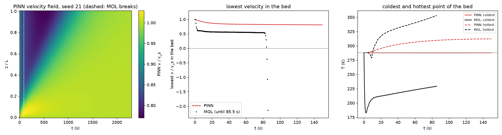

# Known limitations

## 1. Flow reversal (v < 0) inside the bed: IC1 seed 21

IC1 recorder seed 21 is a binary case from the stage (c) domain (whole domain). Its inlet
temperature is Tin = 288.0 K and its final time is t_F = 2299.5 s. The IC1 prefilter passes it
(severity 0.62). Phase 2 put it in the list of hard seeds (`cases.hard_seeds`, see
[phase2_results.md](phase2_results.md)). It has no MOL reference, because the solver of this
repository breaks at t = 85.7 s.

*Left: PINN v/v_s over (t, z/L); the dashed line is where the MOL stops. Middle: lowest velocity
in the bed, PINN and MOL. Right: coldest and hottest point of the bed. The PINN is
`runs/phase3c_long` (stage (c) physics, 200k steps, [phase3_results.md](phase3_results.md)). The
MOL uses the dataset settings (BDF, 281 cells, van Leer) and stops at 85.5 s, just before the
break; it is a diagnostic, not training data. Script: `scripts/plot_flow_reversal.py`; numbers
in `figures/limitations/flow_reversal_seed21.json`.*

### What the MOL solution does

- **First seconds.** A cold zone and a hot zone form next to each other near the inlet. The
  coldest point is 182.6 K at t = 2.5 s, z/L = 0.005. At 2 s the outlet velocity is 6.4 v_s,
  because the bed releases gas. Cooling together with gas release points to desorption, but the
  run does not check this.
- **By 80 s.** The cold zone sits at z/L ≈ 0.14 (228 K) and the hot zone at z/L ≈ 0.10–0.11
  (350 K).
- **From 83 s.** The lowest velocity in the bed falls fast:

| t (s) | lowest v/v_s | where (z/L) | outlet v/v_s | faces with v < 0 (z/L) |
|---|---|---|---|---|
| 80.0 | 0.543 | 0.135 | 0.993 | none |
| 83.0 | 0.435 | 0.228 | 0.811 | none |
| 84.0 | 0.044 | 0.285 | 0.391 | none |
| 84.5 | −0.377 | 0.320 | −0.047 | 0.20–1.00 |
| 85.0 | −1.069 | 0.359 | −0.759 | 0.19–1.00 |
| 85.5 | −2.135 | 0.363 | −0.612 | 0.18–1.00 |

- **From 84.5 s.** The flow points back toward the inlet over the downstream 80 % of the bed,
  outlet included. Gas would enter the bed through the outlet.
- **At 85.7 s the integration breaks.** At that point the lowest concentration is −4.3·10³ C_F
  and the lowest velocity −3·10⁷ v_s (`data/provisorio_MOL_n2_hard_21_bdf_diag.json`).
- **The dT/dt ↔ v fixed-point iteration is not the cause.** It still converges at 85 s: the
  change of dT/dt is 3·10⁻¹¹ after 4 iterations, the same as at 20 s. The solution breaks
  because the flow reverses.

### Why this is outside the model as implemented

- **Outlet condition.** The model assumes the gas flows from the inlet to the outlet. The outlet
  condition (zero gradient, Danckwerts) holds only for outflow. With v(L) < 0, the model would
  need the composition and temperature of the gas entering through the outlet, and it has
  neither.
- **MOL fluxes.** The convective fluxes take face values from the upstream (left) cell
  (`MOLSolver.faces`). When v < 0 these become downwind values, which is unstable. This fits the
  blow-up about 1 s after the reversal starts.
- **No valid reference.** After about 84 s there is no valid reference for this case. Seed 21
  is in no training or validation set.

### What the PINN does

- **No reversal.** v/v_s stays between 0.77 and 1.03 over the whole run. The network could
  represent v < 0: its output v~ = 1 + z~ s N_v has no sign constraint.
- **Almost no cooling, less heating.** The coldest point stays at 287.6 K (MOL: 182.6 K). The
  hottest point is 309 K at 85 s (MOL: 353 K).
- **The cooling happens before the hard initial condition releases.** It happens at
  t = 2.5 s, i.e. t~ = 0.002. That is a fifth of the hard-IC time constant δ = 0.01, which is
  11.5 s for this case. At that time the network outputs are still scaled by
  s = 1 − exp(−t~/δ) ≈ 0.2. This may be part of why the PINN misses the transient; it was not
  tested.
- **The residual does not flag the case.** The table compares seed 21 with seven other cases of
  the same model: validation seeds 71, 74, 80, 86 and 93, and hard seeds 38 and 62
  (`runs/phase3c_long/predict_limitation/summary.json`).

| | seed 21 | the 7 other cases |
|---|---|---|
| mean PDE residual, t~ < δ | 174 | 0.8–1900 |
| mean PDE residual, t~ > δ | 0.013 | 0.007–0.039 |
| PINN outlet v/v_s | 0.77–1.00 | 0.46–1.02 |
| PINN outlet temperature rise | 12.7 K | 0.7–33.6 K |

- **Nothing warns.** Neither the residual nor the IC1 prefilter flags the case. The PINN gives
  a smooth, plausible-looking answer for a case where the model itself does not hold.

### What follows

- **Use.** PINN predictions for cases with strong heat effects near the inlet should be checked
  with a short MOL run of the first ~100 s. For seed 21 the diagnostic run up to the break took
  180 s and shows the reversal at 84.5 s.
- **v23b.** When the v23b dataset arrives, check whether the v23b reference solver handles
  backflow (an inflow condition at the outlet). If it does, the PINN outlet loss term needs the
  same switch. Phase 3 does not change the model.
- **Other cases.** No case of the MOL datasets reverses. The lowest v/v_s is 0.255 over the 60
  Phase 1 cases, 0.311–0.775 over the three validation sets, and 0.548 for hard seed 38. Seed 62
  (MOL over 3 h) was not checked. Nothing in the sampling rules out other reversing cases.

## 2. One unexplained test failure (2026-11-19)

On 2026-11-19 one run of the full suite gave `1 failed, 145 passed`. The run printed only its last
line and the pytest cache was cleared afterwards, so the failing test is unknown. That run started
3 s after a script rewrote `scripts/optuna_stage_b.py` and `tests/test_optuna_stage_b.py` on the
Windows disk (/mnt/c, seen from WSL) to split a commit. The likely cause is that pytest read the
files while they were being changed, but this cannot be confirmed.

It did not happen again: the same version passed 2 times, `tests/test_optuna_stage_b.py` alone
passed 10 times, the final version passed 2 times (148 tests), and in Phase 5 the full suite
passed 5 times in a row (153 passed each time, about 93 s per run, logs in
`runs/phase5_pytest_{1..5}.log`). Without the name of the test there is nothing to fix, so
instead `tests/conftest.py` appends each failed test (time, commit, test and
traceback) to `runs/pytest_failures.log`, so a rare failure leaves a trace.

## 3. The plateau criterion is not safe with a long cosine schedule (Phase 6)

`phase2.plateau_stop` (stop when the validation y R2 gains less than 0.002 over 2 consecutive
evaluations, `src/nnads_ic2/training/plateau.py`) stays off by default (`enabled: false` in
`configs/phase2_base.yaml`); the runs only record where it would have stopped.

With the cosine decay spread over 400 000 steps the learning rate stays high for longer, and all four
400k runs of Phase 6 had a large drop of the validation R2 in the middle of the run, then recovered
when the learning rate became small (`docs/phase6_results.md`, `docs/figures/phase6/`):

| run | lowest R2 (step) | final R2 | criterion would stop at |
|---|---|---|---|
| phase6c_400k_seed0 | 0.728 (125k) | 0.957 | 100k (R2 0.848) |
| phase6c_400k_seed1 | 0.757 (150k) | 0.960 | 125k (R2 0.898) |
| phase6c_hot_400k_seed0 | -0.119 (125k) | 0.957 | 75k (R2 0.877) |
| phase6c_hot_400k_seed1 | 0.546 (175k) | 0.960 | 175k (R2 0.546) |

The criterion reads "no gain" as a plateau, but here "no gain" is often a drop that recovers later.
It would have stopped every 400k run early, two of them on or next to the dip, and kept a much worse
model. It also stops a 200k run that is still improving (phase6c_hot_200k_seed1 at 200k, its last
point). The 200k runs with the same cosine schedule had smaller dips (0.86 at 125k in
phase5c_long_seed0, 0.85 at 50k in the hot runs), so the risk is there too.

What would make it usable: keep the best checkpoint instead of the last one, require a longer window
or compare against the best value so far, and use it only when the learning rate is already small
(late in the cosine). None of this is implemented.
