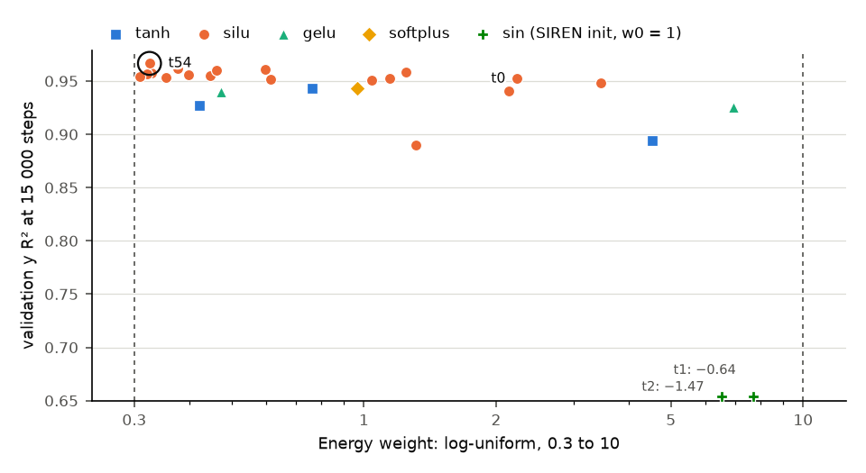
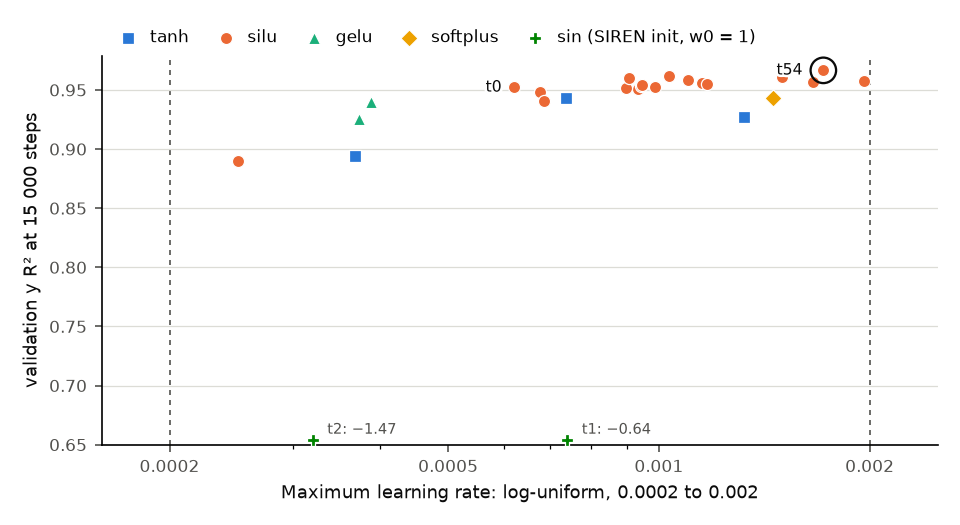
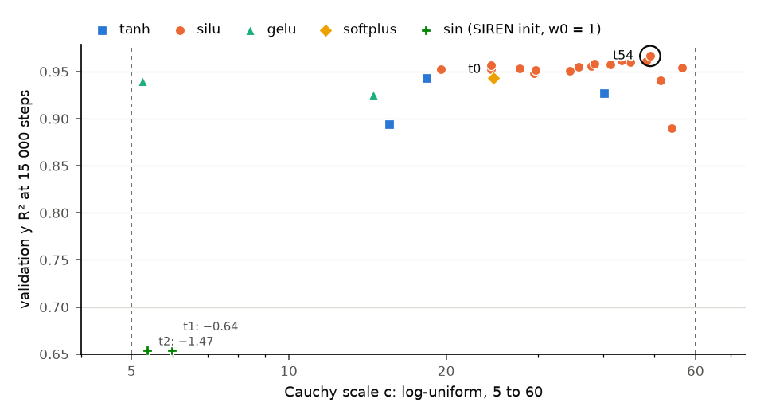
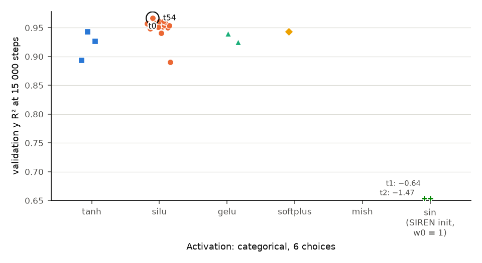

# Second Optuna study on stage (b): results

Run on 2026-11-19 and 2026-11-20 (branch `pinn-v23b`) as approved: 60 trials, 2 of them at a time
on the GPU, then the confirmation of the top 3 at 50 000 steps on stage (b) and of the best of them
on stage (c). Plan, search space and cost estimate: `docs/optuna2_plan.md`. Ranges and distributions
of both studies: `docs/optuna_search_space.md`. Code: `scripts/optuna_stage_b.py --space b2`. Runs:
`runs/optuna_b2/` (trials `t0000` to `t0059`, the journal `study.log`, the confirmation in
`confirm_b/`, `confirm_c/` and `confirm.json`). Figures: `docs/figures/optuna_b2/`.

## Summary

- Trial 0 is trial 26 of the first study, the current default. It gave the same y R² as in the
  first study to the last digit (0.952117537689343), while it trained next to another trial and
  with another memory limit.
- The study found setups that learn faster. The best, trial 54 (8 x 192, SiLU, 128 Fourier features
  at scale 0.31, lr 1.7e-3, energy weight 0.32, Cauchy c 49.1, 1024 theta), reached 0.967 at 15 000
  steps against 0.952 for trial 26, which ranked 13th of the 26 complete trials.
- That lead did not survive the full runs. With 2 seeds at 50 000 steps on stage (b): trial 38
  0.9749, trial 26 0.9733, trial 54 0.9721 and trial 57 0.9719, all within 0.003. On stage (c):
  trial 38 0.9437 against 0.9403. Both gaps are far below the 0.015 that two seeds can differ by.
- Verdict: no change. Trial 26 stays the default, and I changed no config. Trial 38 ties it with a
  smaller network (7 x 224) but is not better.
- Activations: SiLU took 49 of the 60 trials and the whole top 10. Mish got no trial, and the 2
  trials of sin (SIREN init, w0 = 1) did not learn (y R² −0.64 and −1.47). No trial diverged.
  In an extra ablation at the values of trial 54, Mish (0.960) and GELU (0.954) came close to
  SiLU (0.967), tanh and softplus were 0.05 to 0.06 lower, and sin fell to −0.32.
- The edges of the first study are settled: the best depth, number of Fourier features and Fourier
  scale are inside their new ranges. But the energy weight went to the bottom of its new range
  (0.32 of 0.3 to 10), and the learning rate and Cauchy c ended near the top of theirs.
- 2 workers gave no time gain on these networks: each run went about 2.1 times slower next to
  another. The study and the confirmation took 5.8 h, the top of the 5.5 to 5.8 h of the plan.

## Parallel workers and memory

`run --space b2 --workers 2` started 2 worker processes on one study (journal file, as in the first
study), with sampler seeds 0 and 1. Each training process got 6800 MB of GPU memory instead of the
7000 MB of the plan: at the launch Windows used 1.4 to 1.7 GB of the 16.3 GB card, and two processes
at 7000 MB (7.26 GB each with the CUDA context) would have left about 0.1 GB (`docs/optuna2_plan.md`,
decision 1). With two trials running the card showed 15.5 GB in use. No trial ran out of memory, and
the largest peak among the complete trials was 3.5 GB (trial 6, 10 x 288 GELU with 256 Fourier
features).

Every run of the study set `model.siren_w0=1`. So the sin trials used sine layers with w0 = 1 and
the initialization formula of SIREN (Sitzmann et al., 2020). This report calls that activation
"sin (SIREN init, w0 = 1)", because it is not the SIREN of the paper, which uses w0 = 30. Before the
study I trained trial 26 of the first study with sin in place of SiLU, up to step 2 500. With
w0 = 30 it diverged at the learning rate of trial 26 (6.2e-4: NaN by step 500) and did not learn at
2e-4, 6.2e-5 or 2e-5 (y R² −0.11, −0.30 and −1.18 at step 2 500). With w0 = 5 it did not learn either
(−0.08 and −1.58). Only w0 = 1 learned: 0.446 at step 2 500, against 0.852 for SiLU
(`docs/optuna2_plan.md`, Table 4).

Determinism: trial 0 is trial 26 of the first study, queued by hand. It trained next to another
trial and with 6800 MB instead of 3072 MB, and it gave y R² 0.952117537689343, the value of the first
study to the last digit. Every loss column of its training log matches the run of the first study
row by row. So a trial's result depends only on its hyperparameters, not on the worker, the trial
next to it or the memory limit.

## Study

The 60 trials ran from 17:30 to 21:07 on 2026-11-19 (3.63 h). 26 completed and 34 were pruned: 24 at
the first check (5 000 steps), 8 at 7 500 and 2 at 10 000. None failed and none diverged, so the new
rule that records a diverged trial as pruned was never used. The best value went up at trials 19
(0.9556), 20 (0.9580), 38 (0.9612) and 54 (0.9666). Trial 0 ranked 13th of the 26 complete trials.

Table 1. Top 10 complete trials and trial 0: validation y R² of stage (b) at 15 000 steps.

| Rank | Trial | y R² | Mean of the cases | Worst case (case) | T_out RMSE (K) | Network | Fourier features (scale) | lr | Energy weight | Cauchy c | theta |
|---|---|---|---|---|---|---|---|---|---|---|---|
| 1 | 54 | 0.9666 | 0.970 | 0.869 (11) | 12.2 | 8 x 192 silu | 128 (0.31) | 1.7e-3 | 0.32 | 49.1 | 1024 |
| 2 | 57 | 0.9615 | 0.965 | 0.823 (11) | 12.9 | 10 x 224 silu | 128 (0.35) | 1.0e-3 | 0.38 | 43.3 | 1024 |
| 3 | 38 | 0.9612 | 0.965 | 0.816 (11) | 12.4 | 7 x 224 silu | 128 (0.35) | 1.5e-3 | 0.60 | 48.4 | 1024 |
| 4 | 56 | 0.9597 | 0.964 | 0.842 (11) | 12.2 | 10 x 192 silu | 128 (0.31) | 9.1e-4 | 0.46 | 45.0 | 1024 |
| 5 | 20 | 0.9580 | 0.962 | 0.837 (11) | 11.6 | 7 x 256 silu | 128 (0.31) | 1.1e-3 | 1.25 | 38.5 | 2048 |
| 6 | 23 | 0.9573 | 0.962 | 0.837 (11) | 14.2 | 9 x 224 silu | 128 (0.26) | 2.0e-3 | 0.33 | 41.2 | 1024 |
| 7 | 34 | 0.9568 | 0.956 | 0.844 (11) | 17.1 | 9 x 192 silu | 128 (0.46) | 1.7e-3 | 0.32 | 24.4 | 1024 |
| 8 | 19 | 0.9556 | 0.958 | 0.823 (11) | 12.6 | 10 x 192 silu | 128 (0.33) | 1.2e-3 | 0.40 | 37.9 | 1024 |
| 9 | 27 | 0.9547 | 0.957 | 0.828 (11) | 13.0 | 10 x 192 silu | 128 (0.32) | 1.2e-3 | 0.45 | 35.9 | 1024 |
| 10 | 46 | 0.9538 | 0.956 | 0.845 (11) | 12.5 | 10 x 192 silu | 128 (0.21) | 9.5e-4 | 0.31 | 56.6 | 1024 |
| 13 | 0 (trial 26 of the first study) | 0.9521 | 0.953 | 0.839 (11) | 12.0 | 8 x 224 silu | 128 (0.30) | 6.2e-4 | 2.23 | 24.3 | 1024 |

The y R² is pooled over the 16 000 points of the 20 validation cases (the objective). The mean and
the worst of the 20 single-case R² are reported but were not optimized. The Fourier scale multiplies
the sigmas of the model before the first study (sigma_z 2, sigma_t 1).

The best 10 trials have a lot in common:

- all use SiLU and 128 Fourier features, with a scale of 0.21 to 0.46 (trial 26: 0.30);
- the energy weight is 0.31 to 1.25, and below 0.61 in 9 of them (trial 26: 2.23);
- the learning rate is 9.1e-4 to 2.0e-3 (trial 26: 6.2e-4);
- Cauchy c is 24 to 57, 35 or more in 9 of them (trial 26: 24.3);
- 9 of 10 use 1024 theta;
- the networks have 7 to 10 layers of 192 to 256 neurons (trial 26: 8 x 224).

So the second study kept the network type and the Fourier features of trial 26 and changed the loss
and the optimizer: a lower energy weight, a higher learning rate and a larger Cauchy c (a larger c
treats more residuals as plain squares and damps only the largest).

Trial 54 against trial 0: y R² 0.967 against 0.952, the mean of the single cases 0.970 against 0.953,
and the worst case (case 11 for both) 0.869 against 0.839. The front times got better too: the mean
error of the breakthrough time tb went from 21.4 % to 14.1 %, of t50 from 9.7 % to 6.8 % and of t90
from 22.6 % to 17.1 %, and the outlet velocity R² from 0.919 to 0.930. The temperature did not get
better: T_out R² 0.827 against 0.833, RMSE 12.2 against 12.0 K. That is what I expected from the lower
energy weight, since the objective is y alone. Trial 54 is also a smaller network than trial 26: 364
870 weights instead of 475 750.

### Edges of the new ranges

Table 2. Where trial 54 and the top 10 sit in the ranges of the second study.

| Parameter | Range (distribution) | Trial 54 | Position of trial 54 | Top 10 | At an edge? |
|---|---|---|---|---|---|
| Depth | 6 to 12 (integer) | 8 | 33 % | 7 to 10 | no (first study: trial 26 at the top, 8) |
| Width | 128 to 320 (integer, step 32) | 192 | 33 % | 192 to 256 | no |
| Fourier features | 64, 128, 256 | 128 | middle choice | 128 | no (first study: the largest choice) |
| Fourier scale | 0.05 to 1 (log) | 0.31 | 61 % | 0.21 to 0.46 | no (first study: 6 % from the bottom) |
| Learning rate | 2e-4 to 2e-3 (log) | 1.7e-3 | 93 % | 9.1e-4 to 2.0e-3 | near the top |
| Energy weight | 0.3 to 10 (log) | 0.32 | 2 % | 0.31 to 1.25 | at the bottom |
| Cauchy c | 5 to 60 (log) | 49.1 | 92 % | 24 to 57 | near the top |
| Theta per draw | 512, 1024, 2048 | 1024 | middle choice | 1024 in 9 of 10 | no |

Position: 0 % at the bottom of the range, 100 % at the top, on a log scale for the log-uniform
parameters.

The three edges that the second study opened are settled: the best depth, number of Fourier
features and Fourier scale are now inside their ranges. One edge moved instead. The energy weight was
at 17 % of 1 to 100 in the first study (2.2), and now the best trials sit at the bottom of 0.3 to 10:
6 of the top 10 are below 0.41. Two more parameters ended near the top of the ranges that the second
study kept close to trial 26: the learning rate (the first study went up to 3e-3) and Cauchy c (the
first study went up to 100, and its top 10 had values up to 80).

The other figures are in `docs/figures/optuna_b2/` (depth, width, n_fourier, fourier_scale,
n_theta). They show the complete trials only, and the two sin trials sit on the bottom edge with
their values (−0.64 and −1.47).

### Activations

Table 3. Results per activation over the 60 trials.

| Activation | Best y R² | Median y R² | Trials (complete / pruned) | Diverged (NaN) | Median at 5 000 steps |
|---|---|---|---|---|---|
| tanh | 0.9429 | 0.9269 | 5 (3 / 2) | 0 | 0.8004 |
| SiLU | 0.9666 | 0.9543 | 49 (18 / 31) | 0 | 0.8905 |
| GELU | 0.9398 | 0.9325 | 2 (2 / 0) | 0 | 0.8691 |
| softplus | 0.9434 | 0.9434 | 2 (1 / 1) | 0 | 0.8492 |
| Mish | none | none | 0 | 0 | none |
| sin (SIREN init, w0 = 1) | −0.6393 | −1.0527 | 2 (2 / 0) | 0 | −0.7910 |

Best and median: final y R² of the complete trials at 15 000 steps. The last column takes the
validation at 5 000 steps of every trial, pruned ones included, since all of them got that far.

This table does not compare the activations on equal terms. After its random start, TPE kept to
SiLU: 49 of the 60 trials. The other 11 trials were all among the first 13 (trials 1 to 12, most of
them the random start), except one tanh trial (37, pruned at 5 000 steps). So their other parameters
were mostly random draws, while the SiLU trials had TPE's tuning. For example, the two GELU trials had
a learning rate of 3.7e-4 and 3.9e-4, lower than every complete SiLU trial but one (trial 4, 2.5e-4,
which reached only 0.890). The ablation below compares the activations at the same values.

Mish got no trial at all. With 6 activations, the chance that a given one gets none of the 10 random
trials is (5/6)^10, about 16 %, and after the random start TPE samples the activations near the good
trials. So the study says nothing about Mish. The ablation gives it one run.

The two sin trials (1 and 2) completed with y R² −0.64 and −1.47: the network did not learn the outlet.
They ran to the end because they were among the first trials, before the median pruner had the 5
complete trials it needs to start pruning. Their other values were far from the region where SiLU
did well: energy weight 6.5 and 7.7, Cauchy c 5.4 and 6.0, 8 and 9 layers of 288 neurons. Neither
diverged at its learning rate (3.2e-4 and 7.4e-4). Whether sin learns this problem with good values of
the other parameters is again a question for the ablation.

### Importance

As in the first study I used fANOVA over the complete trials with forest seeds 0 to 4, and PED-ANOVA
(top 10 % against all) as a second method.

Table 4. Importance of each parameter (mean over forest seeds 0 to 4 for fANOVA).

| Parameter | fANOVA, 26 complete trials | fANOVA, without the 2 sin trials | PED-ANOVA, without the 2 sin trials |
|---|---|---|---|
| Activation | 0.583 | 0.106 | 0.014 |
| Energy weight | 0.139 | 0.091 | 0.068 |
| lr | 0.125 | 0.465 | 0.080 |
| Cauchy c | 0.112 | 0.057 | 0.435 |
| Fourier scale | 0.015 | 0.133 | 0.335 |
| Number of Fourier features | 0.012 | 0.082 | 0.002 |
| Width | 0.006 | 0.038 | 0.055 |
| Number of theta | 0.005 | 0.005 | 0.004 |
| Depth | 0.002 | 0.025 | 0.006 |

With all complete trials the activation comes first, but only because of the 2 sin trials, whose y
R² of −0.64 and −1.47 lie far below the 0.89 to 0.97 of the other 24. Without them fANOVA ranks the
learning rate first (0.47, from 0.42 to 0.55 over the seeds) and PED-ANOVA ranks Cauchy c first
(0.44). So not even the first place is firm here, and 24 trials are few for 9 parameters. The common
values of the top 10 (above) say more than these numbers.

### Activation ablation (extra, 15 000 steps)

The study gave SiLU 49 trials and Mish none, so Table 3 cannot compare the activations. To compare
them at equal values I trained trial 54 with each of the other 5 activations, everything else equal:
the trial protocol (15 000 steps, seed 0, sin with w0 = 1), in the throwaway study
`runs/optuna_bench/act_ablation`. This was not in the approved plan: 5 extra runs, about 0.8 GPU-h.
WSL restarted during the night while the sin run trained (step 3 200). I ran it again from the
start, and it gave the same validation value at step 2 500 (0.2154), as determinism says it should.

Table 5. Trial 54 with each activation (validation y R² of stage b at 15 000 steps).

| Activation | y R² | Against SiLU | Mean of the cases | Worst case (case) | T_out RMSE (K) |
|---|---|---|---|---|---|
| SiLU (trial 54) | 0.9666 | | 0.970 | 0.869 (11) | 12.2 |
| Mish | 0.9598 | −0.007 | 0.962 | 0.856 (11) | 14.1 |
| GELU | 0.9536 | −0.013 | 0.956 | 0.824 (11) | 17.7 |
| tanh | 0.9195 | −0.047 | 0.913 | 0.803 (11) | 18.1 |
| softplus | 0.9072 | −0.059 | 0.902 | 0.742 (11) | 19.1 |
| sin (SIREN init, w0 = 1) | −0.3208 | −1.287 | −0.575 | −2.483 (6) | 26.8 |

At the values of trial 54 SiLU is still the best, and Mish and GELU, its close relatives (smooth,
non-monotone near zero, not saturating for large x), come next: Mish is 0.007 below, within one-seed
noise, GELU 0.013. tanh and softplus are clearly worse, and sin fails. The sin run reached 0.71 at
5 000 steps and then got worse at every validation, down to −0.32, without a NaN. So with w0 = 1 the
sine layers stay finite but do not hold a solution at this learning rate (1.7e-3). These values were
tuned for SiLU, which favors it. One run per activation, one seed.

## Confirmation (50 000 steps, 2 seeds)

The top 3 complete trials (54, 57 and 38) were trained again for 50 000 steps (the cosine decay of
the learning rate spans the 50 000 steps), with training seeds 0 and 1, on the same stage (b)
validation set, 2 runs at a time. Trial 26 was not trained again: `confirm` reused its 2 runs from
the confirmation of the first study (`runs/optuna_b/confirm_b/t0026_seed*`), which have the same
protocol. The determinism check above shows that the worker and the memory limit do not change a
result, so those runs are what a new run would give, and reusing them saved about 40 min.

Table 6. Confirmation on stage (b): validation y R² at 50 000 steps.

| Setup | y R², seed 0 / seed 1 | Mean ± seed difference | Mean of the cases | Worst case (case 11) | T_out RMSE (K) | Network (weights) |
|---|---|---|---|---|---|---|
| Trial 26 (first study) | 0.9739 / 0.9726 | 0.9733 ± 0.0013 | 0.980 ± 0.001 | 0.842 ± 0.020 | 9.2 ± 0.2 | 8 x 224, FF 128 (0.30), 475 750 |
| Trial 54 | 0.9739 / 0.9703 | 0.9721 ± 0.0036 | 0.976 ± 0.005 | 0.869 ± 0.007 | 9.8 ± 1.2 | 8 x 192, FF 128 (0.31), 364 870 |
| Trial 57 | 0.9664 / 0.9774 | 0.9719 ± 0.0111 | 0.973 ± 0.018 | 0.877 ± 0.010 | 12.1 ± 5.7 | 10 x 224, FF 128 (0.35), 576 550 |
| Trial 38 | 0.9737 / 0.9760 | 0.9749 ± 0.0023 | 0.981 ± 0.002 | 0.862 ± 0.021 | 9.3 ± 0.4 | 7 x 224, FF 128 (0.35), 425 350 |

Here "±" is the difference between the 2 seeds, not a standard deviation. All four use SiLU. The
other parameters of each trial are in Table 1.

The ranking of the study did not hold. At 15 000 steps the three new setups were 0.009 to 0.015
above trial 26. At 50 000 steps the four setups are within 0.003 of each other. Trial 38 has the
best mean, 0.0016 above trial 26, and trials 54 and 57 are about 0.001 below it. 0.0016 is a tenth
of the 0.015 that two seeds of one setup can differ by, and less than the seed difference of trials
54 and 57 here. So the four are tied. Trial 38 goes to stage (c) because it has the best mean, as
planned.

Trial 26 gained 0.021 from 15 000 to 50 000 steps (0.952 to 0.973), trial 54 only 0.006 (0.967 to
0.972). The new setups learn faster, which is what a 15 000 step trial rewards, but they do not end
higher. One likely reason: with the decay over 15 000 steps, a higher peak learning rate gets
further before the rate falls, and over 50 000 steps the lower rate of trial 26 has time to catch
up. I did not test this.

The other metrics tell the same story. The front times of trial 54, much better at 15 000 steps,
are now worse than those of trial 26: the mean error of the breakthrough time tb is 13.4 % against
9.3 %, and of t90 11.0 % against 7.1 %. Trial 38 is close to trial 26 (tb 8.0 %, t50 5.1 % against
4.6 %, t90 5.3 %). The worst case (case 11 in every run) is the one metric where all three new
setups are better: 0.862 to 0.877 against 0.842. That gain (0.020 to 0.035) is about the seed
difference of trial 26 itself (0.020), so I would not count on it.

The outlet temperature is worse with the two lowest energy weights: T_out RMSE 9.8 K for trial 54
(weight 0.32) and 12.1 K for trial 57 (0.38), against 9.2 K for trial 26 (2.2) and 9.3 K for trial
38 (0.60). Seed 0 of trial 57 is the outlier, with a T_out R² of 0.74 and an RMSE of 15.0 K against
0.90 and 9.2 K for its seed 1. With 2 seeds this is a hint, not a result. But it is the risk of a
study that sees only y: a lower energy weight can give up temperature accuracy that nothing in the
objective protects. Trial 57 also has the largest seed difference in y R² of both studies (0.011).
In the first study the seed pairs differed by 0.001 to 0.004.

### Stage (c) test

Trial 38 had the best mean on stage (b), so it went to stage (c) against trial 26, where all 31
parameters vary. The validation set is `data/provisorio_MOL_n2_stage_c_val20.h5`, 20 other cases
than those of stage (b). Again 50 000 steps, 2 seeds, physics only. The runs of trial 26 are again
those of the first study (`runs/optuna_b/confirm_c/t0026_seed*`).

Table 7. Stage (c) test: validation y R² at 50 000 steps.

| Setup | y R², seed 0 / seed 1 | Mean ± seed difference | Mean of the cases | Worst case (case) | T_out RMSE (K) |
|---|---|---|---|---|---|
| Trial 26 (first study) | 0.9410 / 0.9397 | 0.9403 ± 0.0013 | 0.926 ± 0.002 | 0.617 ± 0.005 (11, 6) | 14.9 ± 0.2 |
| Trial 38 | 0.9482 / 0.9393 | 0.9437 ± 0.0089 | 0.934 ± 0.003 | 0.632 ± 0.014 (6, 6) | 14.6 ± 1.3 |

Case numbers here are those of the stage (c) validation set.

The mean of trial 38 is 0.0034 higher, again far below the 0.015 that two seeds can differ by. Its
seed 0 gave the best stage (c) run so far (0.9482), but its seed 1 (0.9393) is below both seeds of
trial 26, and its two seeds differ by 0.009, seven times as much as those of trial 26. The most
consistent difference is the mean of the single cases: both seeds of trial 38 (0.936 and 0.933) are
above both seeds of trial 26 (0.925 and 0.927). The front times and the outlet temperature are a
draw: the mean error of tb is 21.7 % against 20.1 % and of t50 9.1 % against 11.3 %, and T_out RMSE
14.6 K against 14.9 K. So stage (c) shows the same as stage (b): trial 38 is as good as trial 26,
not better.

## Time and cost

Table 8. Wall time with 2 workers against the same runs one at a time.

| Part | Runs | With 2 workers | One at a time | Gain |
|---|---|---|---|---|
| Study | 60 trials, 34 of them pruned | 3.63 h | 3.39 h (estimate) | 0.93x |
| Confirmation, stage (b) | 6 runs of 50 000 steps (trial 26 reused) | 1.70 h | 1.63 h (estimate) | 0.96x |
| Confirmation, stage (c) | 2 runs of 50 000 steps (trial 26 reused) | 0.52 h | 0.51 h (estimate) | 0.99x |
| Study and confirmation | | 5.85 h | 5.53 h | 0.95x |

The "one at a time" times are estimates: for each run I replaced its step time next to another run
by its step time alone. On 2026-11-21 I measured the step time alone of the four networks of the
confirmation (1 500 steps each, `runs/optuna_bench/b2_after.log`): 19.9 ms for trial 26, 18.1 ms for
trial 54, 24.0 ms for trial 57 and 17.9 ms for trial 38. For the 60 trials I used the step-time fit
of the plan, scaled by 0.94, the mean ratio of these four measurements to the fit.

2 workers did not pay off here. Next to another run, each run trained 2.13 times slower than alone
(median over the 60 trials, 1.64 to 2.73), so the GPU was already full with one of these networks,
and the overlap of start-up, compile and validations did not make up for it. The first study gained
1.36x with 4 workers because its small model left the GPU partly idle. The plan expected 1.19x and
5.5 to 5.8 h. The wall time matched (5.85 h) because the trials were cheaper than assumed (TPE stayed
at 192 to 256 neurons): 5.5 GPU-h one at a time, against 6.5 in the plan. One worker would have been
about 5 % faster. The memory limit of 6800 MB was never close: the largest peak was 3.5 GB.

## Verdict

No. No setup of the second study beats trial 26 by more than the seed noise. Trial 38, the best of
them at 50 000 steps, is 0.0016 above it on stage (b) and 0.0034 on stage (c), while two seeds of
one setup can differ by 0.015. Trial 26 stays the default of the stage configs. I changed no config.

Trial 38 ties trial 26 with one layer less (425 350 weights instead of 475 750) and 17.9 ms per
step alone instead of 19.9 ms. That alone is no reason to change, and its seeds differ more
(0.009 on stage c, against 0.001 for trial 26).

The study answered the question of the edges. A deeper network, more Fourier features and a lower
Fourier scale than trial 26 do not help, and of the four new activations only Mish and GELU come near SiLU, none above it. What it found instead is that the trial
length now limits this kind of study. Four setups with quite different values (lr 6.2e-4 to 1.7e-3,
energy weight 0.32 to 2.2, 7 to 10 layers) all end at 0.972 to 0.975 on stage (b) after 50 000
steps. At 15 000 steps the study ranks how fast a setup learns, and among good setups that no longer
tells how high it ends.

What I would do next (proposals only, none of this was run):

1. The long stage (c) run with trial 26, as planned before this study.
2. No third study of this kind. If you want more tuning anyway, it would need trials at the length
   that matters, for example 12 trials of 50 000 steps (about 3.5 GPU-h), and an energy weight kept
   at 0.6 or more, or T_out in the objective, since the two lowest weights gave the worst
   temperature here (a hint from 2 seeds). I do not expect much from it: four quite different
   setups already end within 0.003.

## Caveats

- **Selection on the validation set.** The 60 trials and the confirmation on stage (b) use the same
  20 validation cases. The stage (c) test runs on 20 other cases in the whole domain, so it is the
  check outside the selection.
- **Short trials.** The study ranks setups by what they reach in 15 000 steps, which favors setups
  that learn fast, such as those with a high learning rate and a low energy weight. Here that
  decided the ranking: the lead of 0.015 at 15 000 steps was gone at 50 000.
- **Only y is optimized.** The energy weight went to the bottom of its range, and nothing in the
  objective protects the outlet temperature. At 50 000 steps the two setups with the lowest weights
  had the worst T_out RMSE on stage (b) (9.8 and 12.1 K against 9.2 K).
- **Activations.** TPE gave 49 of the 60 trials to SiLU, Mish got none, and the other activations had
  2 to 5 trials with mostly random values of the other parameters. The ablation is one run per
  activation, with one seed, at 15 000 steps, and at the values that suit SiLU.
- **Seed noise.** Two seeds of one setup can differ by up to about 0.015 in y R² (Phase 3). In the
  first study the seed pairs differed by 0.001 to 0.004, here by up to 0.011 (trial 57 on stage b)
  and 0.009 (trial 38 on stage c). Two seeds are enough to see that the four setups tie, not to
  rank them.
- **Reused runs.** The runs of trial 26 in the confirmation are those of the first study. Trial 0
  reproduced its trial bit for bit with the current code, so a new run should give the same. I did
  not check this at 50 000 steps.
- **Provisional references.** All numbers use the MOL data of this repository, not the v23b dataset.

## References

- Sitzmann, V. et al. (2020) "Implicit neural representations with periodic activation functions",
  NeurIPS 33.
