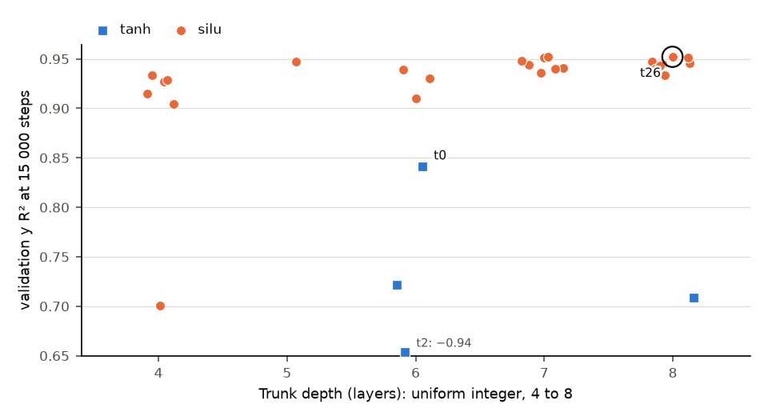
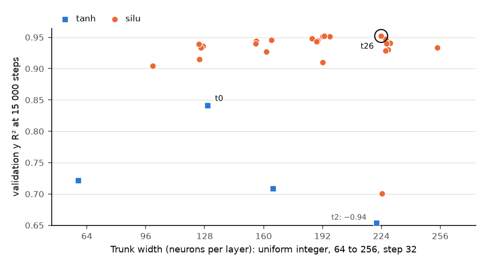
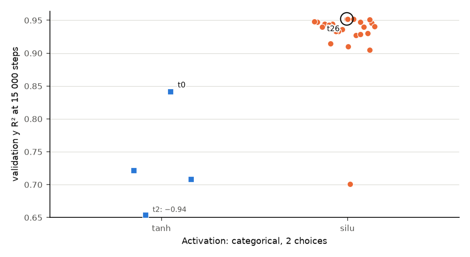
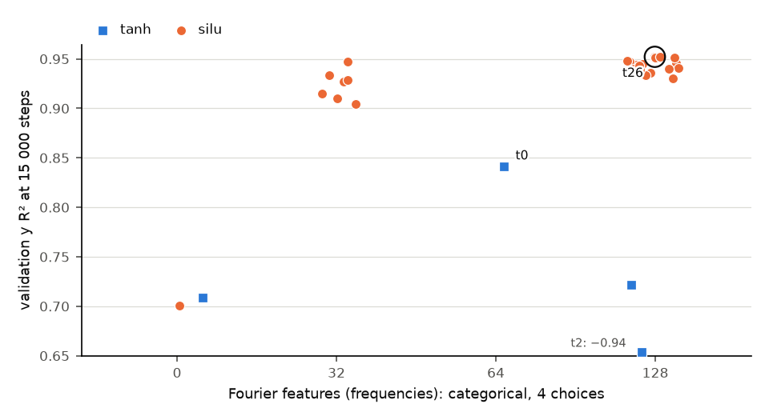
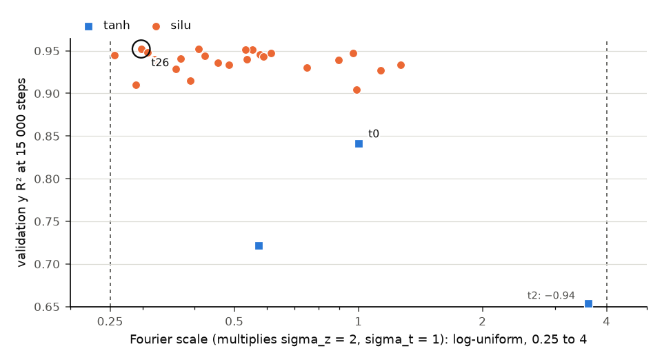
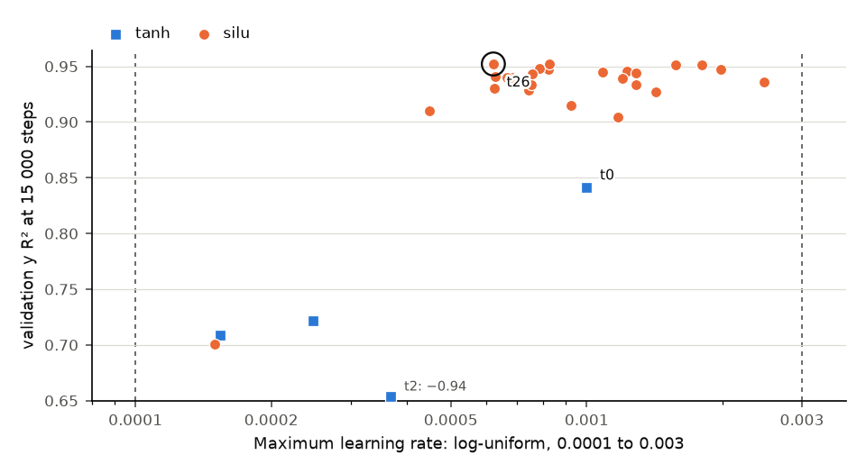
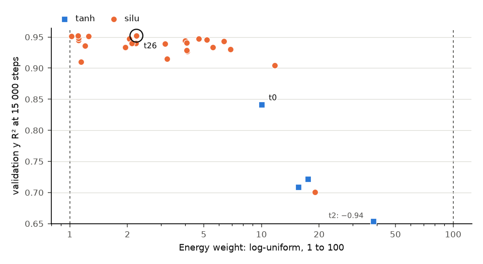
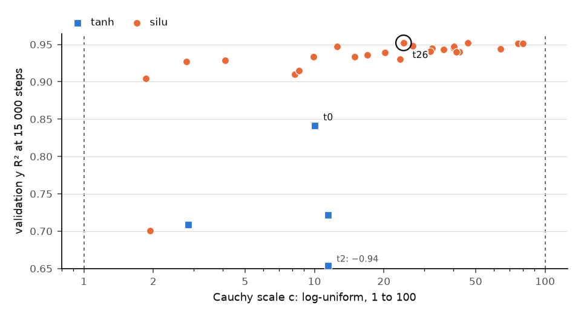
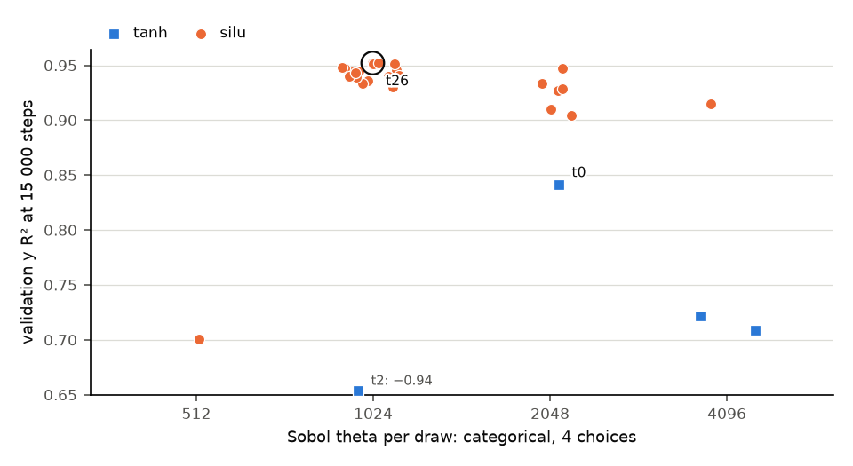

# Search space of the Optuna study on stage (b)

The first Optuna study (plan in `docs/optuna_stage_b.md`, results in `docs/optuna_stage_b_results.md`)
tuned 9 hyperparameters of the physics-only PINN on stage (b). This page explains each one: its range,
how its values were drawn, where trial 26 (the best trial, now the default) sits in the range, and how
the validation y R² changed with it. The last two sections answer whether the activation changes from
layer to layer, and why the second study adds GELU, softplus, Mish and sin, but not ReLU or ELU.

## How the values are drawn

Optuna draws each value from a distribution over a fixed range, and never draws outside it.

- **Uniform integer** (depth, width): every allowed integer is equally likely. The width moves in
  steps of 32.
- **Log-uniform** (Fourier scale, learning rate, energy weight, Cauchy c): the logarithm of the value is
  uniform, so every factor of 10 gets the same share. Between 1 and 100, values from 1 to 10 are drawn
  as often as values from 10 to 100. This suits parameters that act as factors, where going from 1 to 2
  changes as much as going from 10 to 20.
- **Categorical** (activation, number of Fourier features, number of theta): one value from a list.

Trial 0 is the model before the study, which I enqueued. The next trials, about 10, draw from these
distributions at random. After that, the TPE sampler draws more often near the values of the good
trials, still inside the ranges. So if the best values crowd at one end of a range, the study cannot
tell whether a value beyond it would be better. That is the reason for the wider ranges of the second
study.

I count a value as **at the edge** when it is the first or the last choice, or when it is within the
outer 10 % of its range on the scale it is drawn on (the log scale for log-uniform parameters). The
"position" column gives that scale: 0 % is the low end of the range and 100 % the high end.

Table 1. Search space of the first study and trial 26.

| Parameter | What it sets | Range | Distribution | Trial 26 | Position | At the edge? | Top 10 trials |
|---|---|---|---|---|---|---|---|
| Depth | hidden layers of the trunk | 4 to 8 | uniform integer | 8 | 100 % | **yes**, top | 5 to 8, half of them 8 |
| Width | neurons per trunk layer | 64 to 256, step 32 | uniform integer | 224 | 83 % | no, one step below the top | 160 to 224 |
| Activation | function of the hidden layers | tanh, SiLU | categorical | SiLU | n/a | n/a (two choices) | all SiLU |
| Fourier features | random frequencies in z and t (each gives a sine and a cosine) | 0, 32, 64, 128 | categorical | 128 | last choice | **yes**, top | 128 in 9 of 10 |
| Fourier scale | multiplies the spread of the frequencies (sigma_z = 2, sigma_t = 1 at scale 1) | 0.25 to 4 | log-uniform | 0.297 | 6 % | **yes**, bottom | 0.26 to 0.97 |
| Learning rate | maximum of the cosine schedule | 1e-4 to 3e-3 | log-uniform | 6.2e-4 | 54 % | no | 6.2e-4 to 2.0e-3 |
| Energy weight | weight of the energy residual in the PDE loss | 1 to 100 | log-uniform | 2.23 | 17 % | no, but close | 1.0 to 5.2, half of them below 1.3 |
| Cauchy c | residual size where the Cauchy loss stops growing like a square | 1 to 100 | log-uniform | 24.3 | 69 % | no | 12.6 to 80 |
| Theta per draw | Sobol theta of each collocation draw | 512, 1024, 2048, 4096 | categorical | 1024 | second choice | no | 1024 in 9 of 10 |

Source: `runs/optuna_b/study.log` (60 trials: 29 complete, 31 pruned, none failed), the search space
in `scripts/optuna_stage_b.py` (`SPACE_B1`).

Trial 26 sits at the edge in depth, in the number of Fourier features and in the Fourier scale. The
energy weight of trial 26 is not at the edge, but half of the top 10 are, at 1.0 to 1.3. These four
ranges are the ones the second study opens.

## The parameters one by one

Each figure shows every complete trial: its final validation y R² at 15 000 steps against its value.
Squares are tanh trials and circles SiLU trials. Trial 26 is circled and trial 0 (the model before the
study) is labelled. Dashed lines mark the ends of a continuous range. Trial 2 (y R² −0.94) is drawn on
the bottom edge so that the other trials stay readable. Integer and categorical values are spread a
little sideways so that trials with the same value do not hide each other.

### Depth

The SiLU trials improve from 4 layers (best 0.934, median 0.921) to 7 and 8 layers (best 0.952 at
both, median 0.944 and 0.945). The gain flattens between 7 and 8 layers, but 8 is the top of the range,
so the study cannot say whether 9 or more layers would help.

### Width

The best trials have 192 or 224 neurons (best 0.952 at both). Only one SiLU trial had 96 neurons
(0.905) and one had 256 (0.934), too few to say much about the ends of the range.

### Activation

All 10 best trials use SiLU. The 4 complete tanh trials reached 0.842 (trial 0), 0.722, 0.708 and
−0.942. All 6 tanh trials (2 of them pruned) are among trials 0 to 9 and have an energy weight of 7.5
or more, so this figure alone mixes the two effects. The ablation in `docs/optuna_stage_b_results.md`
separates them: SiLU alone, with everything else as in trial 0, raised y R² from 0.842 to 0.921.

### Fourier features

128 frequencies, the largest choice, gave the best results (17 SiLU trials, median 0.944, against
0.927 for the 7 trials with 32). No SiLU trial with 64 frequencies completed, and the only SiLU trial
without Fourier features (0.701) also had an energy weight of 19 and the lowest learning rate.

### Fourier scale

The scale multiplies both spreads of the random frequencies, so a low scale means smoother sines and
cosines at the input. The best trials sit at the low end: trial 26 at 0.297, 6 % of the way from the
bottom of the range (0.25), and 3 of the top 10 below 0.31. The 2 trials without Fourier features have
no scale and are not in this figure.

### Learning rate

No clear trend for SiLU between 4e-4 and 3e-3: the 24 SiLU trials in this band reached 0.905 to
0.952. The trials below 4e-4 were weak, but 3 of the 4 were tanh trials with a high energy weight.

### Energy weight

The clearest pattern of the study. The 23 complete trials with a weight up to 7 reached 0.910 to 0.952,
and the 6 with a weight of 10 or more reached −0.942 to 0.905. Half of the top 10 have a weight between
1.0 and 1.3, right above the bottom of the range (1).

### Cauchy c

Below c the Cauchy loss of a residual grows like its square, and above c it grows only like its
logarithm, so a few huge residuals cannot dominate the loss. Among the SiLU trials with an energy
weight below 7, y R² grows with c (correlation 0.73 against log c): c up to 10 gave 0.910 to 0.934, and
c from 12.6 to 80 gave up to 0.952. The four best trials have c from 24 to 80. These trials also differ
in the other parameters, and TPE drew the later, better trials near each other, so part of this trend
may come from them.

### Theta per draw

1024 theta per draw gave the best results (17 SiLU trials, median 0.944, against 0.928 for the 6 with
2048). Only one SiLU trial completed at 512 (0.701, the same weak trial as above) and one at 4096
(0.915).

## Is the activation the same in every layer?

Yes. One setting, `model.activation`, sets the activation of every hidden layer. In trial 26 these are
the 8 trunk layers (224 neurons) and the hidden layer of each of the 4 output heads (64 neurons, one
head each for c, q, T and v). The output layer of each head is linear. Two other nonlinear parts do
not change with the activation:

- the Fourier features, sin and cos of fixed random frequencies of z and t, in front of the trunk;
- the output transforms of the hard constraints: c and q pass through softplus (never negative), and
  all four outputs are blended with the initial state by s = 1 − exp(−t/δ), so that the initial state
  and the inlet velocity are exact.

Code: `SubNet` in `src/nnads_ic2/models/pinn.py`. The test
`tests/test_pinn.py::test_heads_use_the_activation_of_the_trunk` checks it for every activation.

## Activations of the second study, and why not ReLU or ELU

The PDE residuals contain second derivatives in z: axial dispersion (D_L ∂²c/∂z²) in the mass balances
and axial conduction (λ ∂²T/∂z²) in the energy balance. Automatic differentiation computes them through
every hidden neuron. For a neuron h = σ(a), with a its weighted input,

    ∂²h/∂z² = σ''(a) (∂a/∂z)² + σ'(a) ∂²a/∂z²,

so the second derivative of the activation, σ'', enters every layer.

- **ReLU**, σ(a) = max(0, a): σ' is 0 or 1 and σ'' = 0 everywhere except at a = 0, where it does not
  exist. A ReLU network is linear in its inputs between kinks, and all its bending happens at the
  kinks, where automatic differentiation sees no curvature. Without Fourier features ∂²c/∂z² would be
  zero at every collocation point, so the dispersion and conduction terms would drop out of the
  residual. With Fourier features it is not exactly zero, but it only comes from the curvature of the
  sines and cosines at the input, weighted by slopes of the network that jump at the kinks. The bending
  that the network adds never reaches the loss.
- **ELU**, σ(a) = a for a > 0 and e^a − 1 for a ≤ 0: σ' is continuous, but σ'' jumps from 1 to 0 at
  a = 0, and it is zero for every positive input, as with ReLU. The residual would jump every time the
  input of a neuron crosses zero, in z, t or theta, which makes the loss rough.

The six activations of the second study are smooth: they have continuous derivatives of every order.

Table 2. Activations of the second study.

| Activation | σ(a) | Range of σ | Note |
|---|---|---|---|
| tanh | tanh(a) | −1 to 1 | saturates: σ' and σ'' fall to 0 for large \|a\| (the model before the first study) |
| SiLU | a / (1 + e^−a) | −0.28 to ∞ | close to ReLU for large \|a\|, but smooth (trial 26) |
| GELU | a Φ(a), Φ the normal distribution function | −0.17 to ∞ | close to SiLU (Keras default: the exact form with erf, not the tanh approximation) |
| softplus | ln(1 + e^a) | 0 to ∞ | the smooth version of ReLU, with σ'' = s (1 − s), s the logistic sigmoid |
| Mish | a tanh(ln(1 + e^a)) | −0.31 to ∞ | close to SiLU |
| sin (SIREN) | sin(w0 (x W + b)), w0 = 30 | −1 to 1 | periodic: σ' and σ'' are sines and cosines too, so they do not fade for large inputs |

Source: Keras 3 activations (tanh, silu, gelu, softplus, mish) and `SineDense` in
`src/nnads_ic2/models/pinn.py`.

**SIREN and its initialization.** A SIREN (Sitzmann et al., 2020) uses sin as the activation and
multiplies the input of every sine by w0 = 30, the value of the paper. Its initialization keeps the
spread of w0 (x W + b) the same in every layer, so the output of each layer keeps the same
distribution through the depth. With n inputs to a layer:

- first layer of the network: W drawn uniformly in (−1/n, 1/n);
- every other sine layer (the trunk and the hidden layer of each head): W uniform in
  (−√(6/n)/w0, √(6/n)/w0);
- biases uniform in (−1/√n, 1/√n), as in the reference code of the paper.

The output layers of the heads stay linear with the usual Glorot initialization, as for every other
activation, and the Fourier features stay in front of the trunk.

One side effect: w0 multiplies every change of the weights inside the sine. Adam moves each weight by
about the learning rate per step, whatever the size of its gradient, and the hidden SIREN weights start
about 20 times smaller than Glorot weights of the same layer (uniform limit 0.0055 against 0.116 at 224
neurons). So at the same learning rate a SIREN weight changes about 20 times more, relative to its size,
than a SiLU weight. I measured it: trial 26 with sin in place of SiLU diverged at its learning rate (6.2e-4). The
outlet loss reached 1e8 by step 100 and every loss was NaN from step 300 on (runs/optuna_bench,
`b2_act_sin`). In the study such a run stops with an error at its first validation (step 2500), the
trial is recorded as failed, and the study goes on. Other learning rates and other values of w0, and
how the second study handles this, are in `docs/optuna2_plan.md`.

The other activations keep the Glorot initialization of the first study. The search space of the second
study, its protocol and its cost are in `docs/optuna2_plan.md`.

## References

- Sitzmann, V. et al. (2020) "Implicit neural representations with periodic activation functions",
  NeurIPS 33.
- Tancik, M. et al. (2020) "Fourier features let networks learn high frequency functions in low
  dimensional domains", NeurIPS 33.
- Elfwing, S., Uchibe, E. and Doya, K. (2018) "Sigmoid-weighted linear units for neural network function
  approximation in reinforcement learning", Neural Networks, v. 107, p. 3-11.
- Hendrycks, D. and Gimpel, K. (2016) "Gaussian error linear units (GELUs)", arXiv:1606.08415.
- Misra, D. (2019) "Mish: a self regularized non-monotonic activation function", arXiv:1908.08681.
- Akiba, T. et al. (2019) "Optuna: a next-generation hyperparameter optimization framework", KDD 2019.
