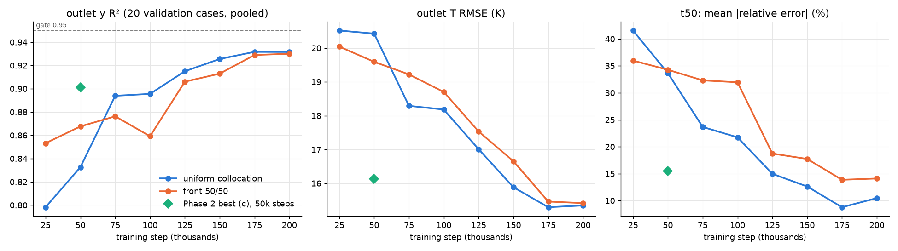

# Phase 3 results (long stage (c) run, front collocation, stage (b) ablation, time marching; provisional MOL data)

## Scope and data

- **Scope.** Phase 3 follows [phase2_results.md](phase2_results.md). It trains only the
  physics-only PINN: no MLP, and no new MOL training data. The hybrid waits for the v23b dataset;
  only its fine-tuning option was prepared.
- **Validation data.** Every validation number below uses the MOL validation sets of Phase 2: 20
  seeds per stage, never seen in training. This is provisional MOL data, not v23b.
- **Metrics.** The metrics and tables are those of Phase 2. The gate metric is the pooled outlet
  R² of y_1 over the 20 cases, with a gate of 0.95.

## Summary

| Item | What was done | Result | GPU h |
|---|---|---|---|
| 1 | Best stage (c) setup of Phase 2 trained for 200 000 steps (4×), validation every 25 000 | y R² **0.932** (Phase 2, 50 000 steps: 0.901); every metric better; flat over the last 25 000 steps; below the 0.95 gate | 0.50 |
| 2 | Half of the collocation points near the fronts (∝ Σ\|∂c~/∂t~\|), half Sobol; 200 000 steps | y R² 0.930: the same as uniform within the run-to-run spread; time errors worse; not kept | 0.51 |
| 3 | Stage (b): Sobol on/off × Cauchy on/off, 50 000 steps, two seeds per corner | Sobol on + Cauchy on is best (0.932 and 0.917, mean 0.925; other corners 0.895–0.902). Either change alone gives about +0.007. The 50 fixed θ get the late front times right | 1.01 |
| 4 | Time marching on stage (b): 4 windows of t~, 12 500 steps each | y R² 0.821, against 0.900–0.927 without marching; worse in every window; +30 % GPU time; not pursued | 0.17 |
| 5 | Fine-tuning option for the hybrid (physics run, then outlet data at a fixed λ_data = 0.1) | ready and smoke-tested (300 steps); not run, it waits for the v23b data | 0.01 |
| 6 | Seed 21: flow reversal (v < 0) | documented in [known_limitations.md](known_limitations.md), with the PINN ṽ(z, t) | – |

Total: 2.2 GPU h over 11 training runs and 2 smoke tests. No new MOL training data was made.

**Read first: the run-to-run spread (Section 1).** Two runs of the same configuration can differ
by up to 0.027 in y R². A single-run difference of that size is not evidence.

## 1. Run-to-run spread

### Same configuration and seeds, run twice

- **The runs.** The stage (b) physics run of Phase 2 (`phase2b_physics`) was run again in
  Phase 3: corner "Sobol on, Cauchy off" of the ablation (`phase3b_abl_sobol1_cauchy0`). Both use
  the same configuration and the same seeds. The config files differ only by keys added in Phase
  3, all set to their old behaviour.
- **The losses drift apart.** For the first 1000 steps they agree to 7 significant digits:
  0.4538941 vs 0.4538940 at step 100, and 0.3499218 vs 0.3499192 at step 1000. Then they drift
  apart: 0.1913 vs 0.1900 at step 5000, and 0.093 vs 0.329 at step 10 000.
- **Validation y R²:** 0.927 vs 0.903.
- **Cause.** This is the pattern of floating-point non-determinism on the GPU, amplified by
  training. TensorFlow op determinism is off, and reductions can run in a different order from
  run to run.

### Another network and batch seed

- **A third run.** The same configuration was run once more with another network and batch seed
  (`runtime.seed` 1, same θ and collocation points). It gives 0.900.
- **The ablation corners.** Each of the four corners of the ablation (Section 4) has two seeds.
  The two runs of a corner differ by 0.001 to 0.015 in y R². The three runs of the corner
  "Sobol on, Cauchy off" span 0.900–0.927.
- **What follows.** A difference below about 0.02–0.03 between two single runs is not evidence.
  Where it could (item 3), Phase 3 compares means of two runs.

## 2. Item 1: long stage (c) run (200 000 steps)

### Setup

- **Configuration:** `configs/phase3_stage_c_long.yaml`. It is the best stage (c) setup of Phase 2
  (`phase2c_physics_robust`) trained for 200 000 steps instead of 50 000:
  - physics only;
  - Cauchy loss on the PDE residual (c = 10);
  - 6 × 128 network;
  - lr 1e-3 with cosine decay, which now spans the 200 000 steps;
  - 2048 Sobol θ renewed every 10 epochs (2622 steps).
- **Checkpoints:** every 10 000 steps, all kept, in `runs/phase3c_long/ckpt/`.
- **Validation curve.** Outlet metrics on the 20 validation seeds every 25 000 steps
  (`phase2.eval_every`, `runs/phase3c_long/val_curve.csv`). It took 3 s in all, which is not
  counted in the GPU hours.
- **Figure.** `scripts/plot_val_curves.py` draws the curves. The orange line is the run of
  Section 3.

*Validation metrics against the training step.*
- *Blue: uniform collocation (item 1).*
- *Orange: half of the points near the fronts (item 2).*
- *Green diamond: the Phase 2 run (same setup, 50 000 steps).*

### Validation curve

| Step | y R², uniform | y R², fronts | T_out RMSE (K), uniform | T_out RMSE (K), fronts | t50 error, uniform | t50 error, fronts |
|---|---|---|---|---|---|---|
| 25 000 | 0.798 | 0.853 | 20.52 | 20.04 | 41.6 % | 36.0 % |
| 50 000 | 0.833 | 0.868 | 20.43 | 19.59 | 33.7 % | 34.3 % |
| 75 000 | 0.894 | 0.876 | 18.29 | 19.22 | 23.7 % | 32.3 % |
| 100 000 | 0.896 | 0.859 | 18.18 | 18.70 | 21.7 % | 32.0 % |
| 125 000 | 0.915 | 0.906 | 17.01 | 17.53 | 15.0 % | 18.7 % |
| 150 000 | 0.926 | 0.913 | 15.88 | 16.65 | 12.6 % | 17.7 % |
| 175 000 | **0.932** | 0.929 | 15.29 | 15.46 | 8.8 % | 13.9 % |
| 200 000 | **0.932** | 0.930 | 15.34 | 15.41 | 10.5 % | 14.1 % |

### Final validation, 20 stage (c) seeds

| Run | y RMSE | y R² | T_out RMSE (K) | T_out R² | v_out/v_s RMSE | v_out R² |
|---|---|---|---|---|---|---|
| Phase 2 best (c), 50 000 steps | 0.0851 | 0.901 | 16.13 | 0.54 | 0.1956 | 0.46 |
| uniform, 200 000 steps | 0.0709 | **0.932** | 15.34 | 0.58 | 0.1721 | 0.58 |
| fronts 50/50, 200 000 steps | 0.0716 | 0.930 | 15.41 | 0.58 | 0.1793 | 0.54 |

**Characteristic times: mean |relative error| (cases where both curves reach the level)**

| Run | tb (c, 5 %) | t10 | t50 | t90 | ts (y, 95 %) | ts_c (c, 95 %) |
|---|---|---|---|---|---|---|
| Phase 2 best (c) | 34.7 % (20/20) | 27.6 % (20/20) | 15.5 % (20/20) | 31.4 % (15/20) | 29.3 % (7/15) | 30.2 % (6/12) |
| uniform, 200 000 | 20.9 % (20/20) | 18.4 % (20/20) | 10.5 % (20/20) | 14.1 % (17/20) | 25.3 % (14/15) | 16.5 % (9/12) |
| fronts, 200 000 | 23.0 % (20/20) | 19.3 % (20/20) | 14.1 % (20/20) | 23.8 % (17/20) | 25.1 % (12/15) | 23.3 % (9/12) |

**Characteristic times: mean signed error (%)**

| Run | tb | t10 | t50 | t90 | ts | ts_c |
|---|---|---|---|---|---|---|
| Phase 2 best (c) | −20.2 | −18.1 | +2.8 | +29.8 | +25.1 | +26.7 |
| uniform, 200 000 | −17.8 | −17.2 | −2.0 | +8.6 | +23.0 | +15.4 |
| fronts, 200 000 | −15.4 | −14.9 | +5.1 | +22.5 | +23.1 | +20.9 |

**Internal fields: RMSE over the regular (z~, t~) grid**

| Run | c~_0 | q~_0 | c~_1 | q~_1 | T~ | T (K) | v~ |
|---|---|---|---|---|---|---|---|
| Phase 2 best (c) | 0.066 | 0.171 | 0.057 | 0.157 | 0.395 | 7.59 | 0.082 |
| uniform, 200 000 | 0.050 | 0.132 | 0.041 | 0.107 | 0.294 | 6.68 | 0.070 |
| fronts, 200 000 | 0.053 | 0.135 | 0.045 | 0.124 | 0.313 | 6.86 | 0.073 |

**Mole balance and cost**

| Run | Moment gas 1, PINN vs ref | Moment gas 0, PINN vs ref | Reference vs theory (1 / 0) | Steps | Training | GPU h | ms/step | Inference |
|---|---|---|---|---|---|---|---|---|
| Phase 2 best (c) | 11.5 % | 13.8 % | 8.6 % / 3.4 % | 50 000 | 8.4 min | 0.140 | 9.6 | 2.1 ms |
| uniform, 200 000 | 4.7 % | 6.5 % | 8.6 % / 3.4 % | 200 000 | 29.7 min | 0.495 | 8.7 | 1.2 ms |
| fronts, 200 000 | 8.7 % | 7.8 % | 8.6 % / 3.4 % | 200 000 | 30.4 min | 0.506 | 8.8 | 1.5 ms |

### Observations

- **Points of one schedule.** The curve points belong to one 200 000-step schedule, whose
  learning rate is still high early on. They are not what a shorter run would reach. The Phase 2
  run, with its learning rate fully decayed at 50 000 steps, is ahead of the long run at 50 000
  steps (0.901 vs 0.833). The long run passes it between 100 000 and 125 000 steps.
- **Four times the steps: y R² 0.901 → 0.932 (+0.031).** The other metrics improve too:

| Metric | Phase 2, 50 000 steps | 200 000 steps |
|---|---|---|
| T_out RMSE | 16.13 K | 15.34 K |
| v_out R² | 0.46 | 0.58 |
| tb error | 34.7 % | 20.9 % |
| t50 error | 15.5 % | 10.5 % |
| t90 error | 31.4 % | 14.1 % |
| c~_1 field RMSE | 0.057 | 0.041 |
| T field RMSE | 7.59 K | 6.68 K |
| moment of gas 1 vs reference | 11.5 % | 4.7 % |

  The y R² gain is about the largest same-configuration difference of Section 1 (0.027). The
  improvement is consistent across all metrics, but it is still one run against one run.
- **Flat at the end.** y R² is 0.9317 at 175 000 steps and 0.9316 at 200 000. The run has
  converged at the end of the decay. More steps with this schedule would likely add little, and
  0.95 was not reached.
- **What is still wrong.** The pattern of Phase 2 remains, only smaller:
  - the fronts start early (tb −17.8 %) and end late (ts +23.0 %), so they are too spread;
  - the outlet temperature and velocity stay weak (R² 0.58 each).
- **Other cases of the stage (c) domain.**
  - The 10 Phase 1 validation cases: y R² 0.818 → 0.896.
  - Fit of the 50 Phase 1 training cases (no data used, only their θ in the collocation):
    0.907 → 0.950.

## 3. Item 2: collocation near the concentration fronts

### Method

- **Configuration:** `configs/phase3_stage_c_front.yaml`, `theta_colloc.front_frac: 0.5`.
- **Renewals.** At every renewal of the collocation θ (every 2622 steps), half of the new points
  of each θ row go near the fronts of the current network:
  - 4 uniform candidates are drawn per point;
  - candidates are kept, without replacement (Gumbel top-k), with probability proportional to
    w = Σ_i |∂c~_i/∂t~|;
  - every row gets the same number of front points.
- **The rest.** The other half stays uniform (Sobol). RAR is unchanged.
- **Why this weight.** Along a monotone front, ∫|∂c/∂t| dt = |Δc| whatever the front width. So
  the points spread evenly in z~ and, at each z~, gather around the time the front passes.
- **Comparison.** Everything else is as in item 1, including the steps and the curve.

### Results

They are in the tables of Section 2 (orange line in the figure).

- **Ahead early.** At 25 000 steps y R² is 0.853 vs 0.798, at 50 000 steps 0.868 vs 0.833. Both
  are mid-schedule points.
- **Behind from 75 000 to 175 000 steps.** The largest gap is at 100 000 steps: 0.859 vs 0.896.
- **Same at the end:** 0.930 vs 0.932, well inside the run-to-run spread.
- **Time errors worse at the end:**
  - t50: 14.1 % vs 10.5 %;
  - t90: 23.8 % vs 14.1 %, signed +22.5 % vs +8.6 % (the end of the front comes late);
  - moment of gas 1: 8.7 % vs 4.7 %.
- **Cost.** The front weights at the 76 renewals cost 0.7 min (+2 %).

### Verdict

- No gain, so the uniform collocation stays.
- A hypothesis, not tested: the weight follows the fronts of the current network. Where these are
  late or too spread, the extra points reinforce them. RAR already adds points where the residual
  is large.

## 4. Item 3: ablation on stage (b)

### Setup

- **Runs.** Each corner was run with two seeds (`runtime.seed` 0 and 1: network initialization
  and batch order; the same θ and collocation points). The Phase 2 run of the corner "Sobol on,
  Cauchy off" is added as a third run of that corner.
- **Common to all.** Every run has 50 000 steps and is physics only. Validation is on the 20
  stage (b) seeds.

| Corner | Setting | Collocation θ | Pool | `configs/` |
|---|---|---|---|---|
| Sobol on | collocation of Phase 2 | 2048 Sobol θ renewed every 10 epochs (2561 steps), plus the base case; 40 960 θ seen in a run | 2049 × 512 = 1 049 088 points | `phase2_stage_b.yaml` |
| Sobol off | — | 50 Sobol θ drawn once and kept, plus the base case | 51 × 20 560 = 1 048 560 points | `phase3_stage_b_fixed_theta.yaml` |
| Cauchy on | `loss.robust_c: 10`, as in stage (c) | — | — | — |
| Cauchy off | plain mean squares, as in stage (b) of Phase 2 | — | — | — |

The Sobol-off pool has the same size as the Sobol-on pool, and the batch, steps and RAR are the
same.

### y R² on the 20 validation seeds (seed 0, seed 1)

| | Cauchy off | Cauchy on |
|---|---|---|
| Sobol on | 0.903, 0.900 (Phase 2 run: 0.927); mean 0.902 | **0.932, 0.917; mean 0.925** |
| Sobol off | 0.894, 0.895; mean 0.895 | 0.908, 0.894; mean 0.901 |

### Main metrics of every run

| Run | y R² | T_out RMSE (K) | v_out R² | tb | t50 | t90 (signed) | c~_1 field | T field (K) | Moment gas 0, PINN vs ref |
|---|---|---|---|---|---|---|---|---|---|
| Sobol on, Cauchy off: Phase 2 | 0.927 | 12.82 | 0.87 | 30.2 % | 13.8 % | 24.3 % (+22.8) | 0.046 | 6.53 | 9.7 % |
| Sobol on, Cauchy off: seed 0 | 0.903 | 15.06 | 0.81 | 37.3 % | 18.0 % | 30.2 % (+29.3) | 0.055 | 7.87 | 15.5 % |
| Sobol on, Cauchy off: seed 1 | 0.900 | 14.96 | 0.80 | 41.0 % | 19.2 % | 31.7 % (+30.7) | 0.058 | 8.00 | 17.1 % |
| Sobol on, Cauchy on: seed 0 | 0.932 | 13.12 | 0.88 | 26.3 % | 14.0 % | 21.6 % (+18.1) | 0.046 | 6.44 | 9.1 % |
| Sobol on, Cauchy on: seed 1 | 0.917 | 13.75 | 0.85 | 30.2 % | 15.3 % | 21.3 % (+19.1) | 0.051 | 6.90 | 12.6 % |
| Sobol off, Cauchy off: seed 0 | 0.894 | 13.49 | 0.76 | 33.1 % | 14.6 % | 14.1 % (−0.7) | 0.054 | 8.28 | 17.9 % |
| Sobol off, Cauchy off: seed 1 | 0.895 | 14.86 | 0.75 | 37.2 % | 13.5 % | 17.0 % (+2.3) | 0.054 | 8.89 | 21.9 % |
| Sobol off, Cauchy on: seed 0 | 0.908 | 13.20 | 0.79 | 37.2 % | 13.0 % | 16.0 % (+5.5) | 0.053 | 8.09 | 15.6 % |
| Sobol off, Cauchy on: seed 1 | 0.894 | 14.15 | 0.80 | 35.2 % | 14.9 % | 14.0 % (+5.8) | 0.054 | 7.90 | 11.1 % |

*The times are mean |relative errors|; t90 has the mean signed error in brackets. The
reference's own moment errors vs theory are 4.6 % / 8.9 % (gas 1 / gas 0) for every run.*

### Observations

- **Best corner: Sobol on with Cauchy on.**
  - Its two runs give 0.932 and 0.917 (mean 0.925). The other corners average 0.895–0.902.
  - It is also better on most other metrics:

| Metric | Sobol on, Cauchy on | other three corners (Phase 3 runs) |
|---|---|---|
| T field RMSE | 6.4–6.9 K | 7.9–8.9 K |
| v_out R² | 0.85–0.88 | 0.75–0.81 |
| tb error | 26–30 % | 33–41 % |
| moment of gas 0 | 9–13 % | 11–22 % |

  - The Phase 2 run of "Sobol on, Cauchy off" (0.927) is the only run of another corner at its
    level.
- **Each change alone gives little; together they give +0.030.**

| Change | mean y R² |
|---|---|
| Cauchy alone (Sobol off) | 0.895 → 0.901 |
| Sobol alone (Cauchy off) | 0.895 → 0.902 |
| both | 0.895 → 0.925 |

  One reading, not tested: renewing θ keeps bringing θ with large residuals, and the Cauchy loss
  keeps them from dominating the gradient. That is why the Cauchy loss was introduced in stage
  (c) (Phase 2, Section 4).
- **The 50 fixed θ get the end of the front right.**
  - t90 signed error: −0.7 % to +5.8 % with 50 fixed θ, against +18 % to +31 % with renewed θ.
  - ts and ts_c follow the same pattern (Sobol off: −0.2 % to +14 %; Sobol on: +23 % to +71 %).
  - With renewed θ, the PINN's fronts end too late on stage (b), as on stage (c) (Section 2).
  - Each fixed θ has 40 times more points. Whether this resolution per θ is the cause was not
    tested.
- **Choice for stage (b):** the Cauchy loss with renewed Sobol θ, the setup stage (c) already
  uses.

## 5. Item 4: time marching on stage (b) (proof of concept)

### Method

- **Configuration:** `configs/phase3_stage_b_march.yaml`, `phase2.march_windows: 4`.
  [0, t~_F] = [0, 2] is cut into 4 windows of 0.5. They train one after the other, 12 500 steps
  each, so 50 000 steps in all, as in the ablation runs.
- **Window 0** is the plain PINN, with the hard initial condition at t~ = 0.
- **Window k ≥ 1** (`MarchingWindow`, `src/nnads_ic2/models/pinn.py`):
  - its initial condition is the state window k−1 (frozen) reaches at its start t_k;
  - that condition is imposed exactly, with the same blend as the PINN's hard initial condition:
    c~ = (1 − s) c~_prev(z~, t_k, θ) + s softplus(N_c), with s = 1 − exp(−(t~ − t_k)/δ);
  - q~, T~ and ṽ are built the same way;
  - its network starts from the weights of the network of window k−1.
- **Each window's training:**
  - its own collocation pool, of the same size as the whole-range run (so 4 times denser in
    time);
  - its own boundary points and causal slices, over the window only;
  - θ renewals and RAR as usual;
  - the learning-rate schedule restarts in each window.
- **Evaluation.** `MarchedPINN` answers each point with the window that holds its t~.
- **Baseline.** The same configuration without marching: the corner "Sobol on, Cauchy off" of
  Section 4, with three runs (0.927, 0.903, 0.900).

### Results

| Run | y R² | T_out RMSE (K) | v_out R² | t50 | t90 (signed) | T field (K) | Moment gas 1, PINN vs ref | GPU h | ms/step |
|---|---|---|---|---|---|---|---|---|---|
| time marching, 4 × 12 500 steps | 0.821 | 24.08 | 0.55 | 35.9 % | 43.0 % (+43.0) | 12.32 | 23.6 % | 0.166 | 8.9 → 11.7 (window 0 → 3) |
| no marching, 50 000 steps (three runs) | 0.900–0.927 | 12.8–15.1 | 0.80–0.87 | 13.8–19.2 % | 24.3–31.7 % (+22.8 to +30.7) | 6.5–8.0 | 6.0–9.3 % | 0.127–0.147 | 8.7–9.8 |

**Outlet y_1 RMSE per time window.** These are the errors of the outlet curves of the 20
validation seeds, grouped by the window that holds each time point:

| t~ window | [0, 0.5) | [0.5, 1) | [1, 1.5) | [1.5, 2] |
|---|---|---|---|---|
| time marching | 0.089 | 0.165 | 0.101 | 0.057 |
| no marching (three runs) | 0.046–0.064 | 0.124–0.138 | 0.040–0.056 | 0.029–0.038 |

### Observations

- **Worse in every window, already in the first.** Window 0 is a plain PINN on [0, 0.5] with a
  quarter of the steps. Trained this way, a window does not reach the quality the whole-range run
  reaches in 50 000 steps.
- **The errors carry over.** Window 2 has about twice the error of the baselines. Every
  characteristic time comes late (mean signed error +34 % to +95 %).
- **Cost:** +30 % GPU time for the same number of steps. Each window also evaluates the earlier
  windows, so the step time grows from 8.9 ms (window 0) to 11.7 ms (window 3). There are 4 times
  the parameters (546 840), and an outlet curve takes 6.7 ms of inference instead of 1.2–1.8 ms.
- **Verdict.** With the same number of steps, time marching is worse, and it was not pursued.
  Variants not tried: more steps per window, overlapping windows, and continuity as a soft loss
  term instead of the hard blend.

## 6. Item 5: fine-tuning option for the hybrid (ready, not run)

### How it works

`phase2.init_from: <run directory>` makes `scripts/train_phase2.py` start from a trained run:

- `pretrained_setup` (`src/nnads_ic2/experiment.py`) takes the run's network settings, its
  dT_ratio and its θ scaler. The inputs and scales are then exactly those the weights were
  trained with.
- `model.weights.h5` is loaded before training.
- Training then runs as usual, with a fresh Adam state and a fresh collocation pool.

### Configuration

`configs/phase3_finetune_c.yaml`:

- start from `runs/phase3c_long` (stage (c) physics, Section 2);
- add the outlet data at λ_data = 0.1, fixed (`loss.adaptive.fixed: [data]`, no annealing);
- lr 1e-4 with cosine decay;
- 20 000 steps.

The steps and the learning rate are first guesses.

### Smoke test

The test checks only the code path, not hybrid results. It ran for 300 steps on the
provisional outlet data of the 50 Phase 1 training cases (`runs/phase3c_finetune_smoke`).

- The run started from the long run: validation y R² 0.936 after 300 steps, against 0.932 for
  the long run. A wrong or missing weight load would have given a much lower value.
- λ_data was 0.1 at every logged step.
- The test `test_pretrained_setup_reuses_network_scales_scaler_and_weights` checks the network
  settings, dT_ratio, scaler and weights.

### With the v23b data

Set `data.path` to the v23b file and `--val` to its validation split. The loader is in Section 8
of the Phase 2 report.

## 7. Item 6: seed 21, flow reversal

See [known_limitations.md](known_limitations.md), which has the figure of the PINN ṽ(z, t).

- **The MOL.** The flow reverses (v < 0) from t = 84.5 s over z/L 0.20–1.00, outlet included,
  and the solver breaks at 85.7 s. The outlet condition and the upwind fluxes of the model assume
  v > 0, so there is no valid reference for this case.
- **The PINN** (`runs/phase3c_long`) keeps v/v_s between 0.77 and 1.03. It misses the cooling of
  the bed: 287.6 K against 182.6 K in the MOL.
- **Nothing warns.** Its PDE residual stays within the range of normal cases, so the residual does
  not flag the case.
- **The datasets.** No case of the MOL datasets reverses: the lowest v/v_s over all of them is
  0.255.

## 8. Cost

| Runs | GPU h |
|---|---|
| item 1: `phase3c_long` | 0.495 |
| item 2: `phase3c_front` | 0.506 |
| item 3: 8 ablation runs (seed 0: 0.497; seed 1: 0.512) | 1.009 |
| item 4: `phase3b_march` | 0.166 |
| smoke tests: fine-tuning, 300 steps (0.006); time marching, 400 steps (0.025) | 0.031 |
| **total** | **2.21** |

- **What GPU h counts.** It is training time on the GPU only: without the periodic validation
  (3 s per long run) and without the final evaluation. GPU inference for item 6 took a few
  minutes and is not counted.
- **MOL.** One diagnostic run of seed 21 up to 85.5 s, for the figure of item 6. It runs on the
  CPU and is not training data. There was no other MOL computation.

## 9. What worked, what did not, next steps

### Worked

- **Longer training on stage (c).** 0.901 → 0.932 with 4 times the steps, and all metrics
  improve. The curve is flat at the end of the decay.
- **Cauchy loss with renewed Sobol θ on stage (b).** It is the best corner of the ablation, with
  two seeds. It is the setup stage (c) already uses.
- **Fine-tuning for the hybrid.** The code path runs end to end.

### Did not work

- **Collocation near the fronts (item 2):** the same final y R², and worse front times.
- **Time marching with the same number of steps (item 4):** worse in every window.
- **The 0.95 gate on stage (c):** not reached; the best run gives 0.932.

### Also learned

- **Run-to-run spread.** One configuration can spread by up to 0.027 in y R². A single-run
  difference below that is noise. Compare means of at least two seeds, or turn on TensorFlow op
  determinism (its cost in speed was not measured).
- **The residual does not detect cases outside the model** (seed 21, flow reversal).
- **The remaining errors have the same shape since Phase 2:** fronts too spread (they start
  early and end late), and a weak outlet temperature and velocity.

### Next steps (proposals, none tried)

1. **v23b dataset.** Run `configs/phase3_finetune_c.yaml` with `data.path` set to the v23b file.
   Compare it with the physics run on the v23b validation split.
2. **Stage (c) beyond 0.932.** Two candidates, each to be run with two seeds:
   - **More points per θ.** On stage (b), the 50 fixed θ (40 times more points per θ) got the end
     of the front right. Fewer renewed θ with more points each, or a larger pool, could do the
     same.
   - **A second learning-rate decay** started from the checkpoint of the long run.
3. **Backflow.** Check whether the v23b reference solver handles backflow (seed 21). If it does,
   the PINN's outlet condition needs the same switch.

## 10. Incidents

- No run failed or hung. The time-marching run skipped no step.
- The two smoke tests and the test suite ran while the seed-1 ablation runs trained on the GPU.
  Those runs show 8.8–8.9 ms/step, against 8.7 for seed 0, so their GPU hours may be a few
  percent high. Results do not depend on timing.
- The ablation corner "Sobol on, Cauchy off" with the same seeds as Phase 2 gave 0.903 instead
  of 0.927. This was the first sign of the run-to-run spread of Section 1, not an error.
