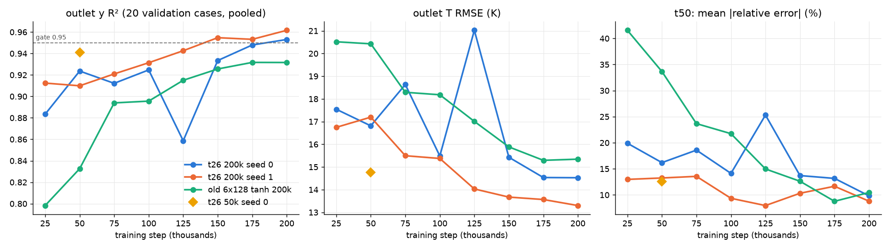
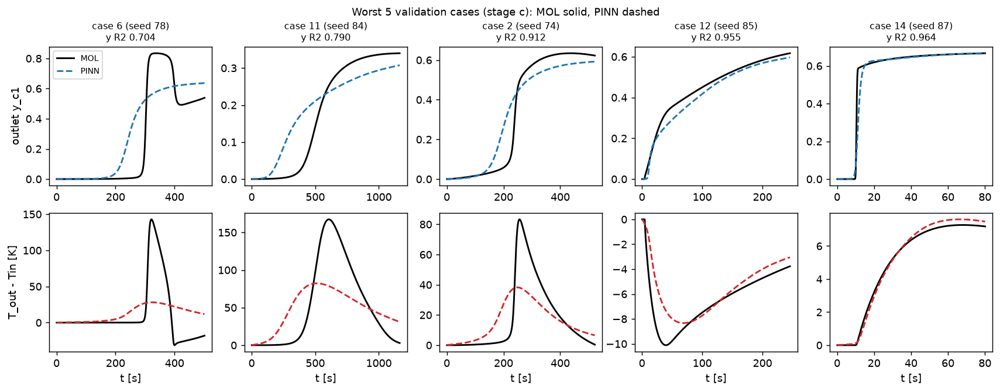
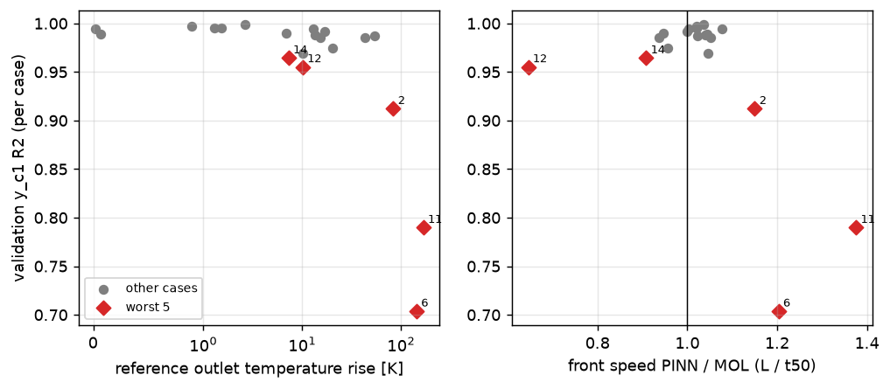
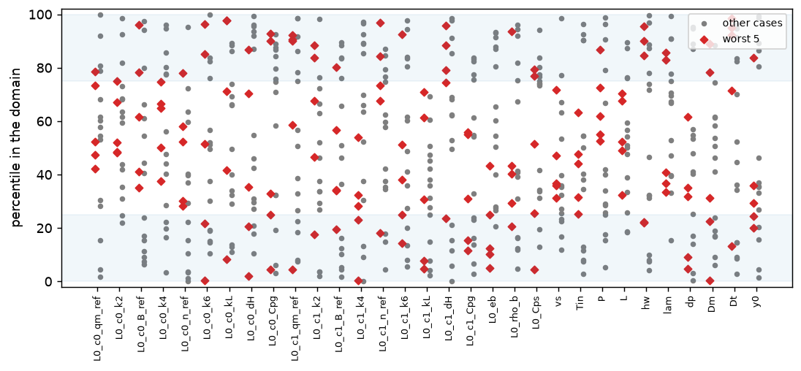

# Phase 5 results (long stage (c) run with the default, stage (a), cheap version, worst cases)

Run on 2026-11-21 (branch `pinn-v23b`) as approved, after the hyperparameter search was closed with
trial 26 of the first Optuna study as the default (8 x 224 SiLU, 128 Fourier features at scale
0.297, lr 6.2e-4, energy weight 2.23, Cauchy c 24.3, 1024 theta). One run on the GPU at a time.
Physics only, no new solver data: training and validation use the provisional MOL files of Phase 2
(`data/provisorio_MOL_n2_*`), so these numbers stay apart from the future v23b results.

Configs: `configs/phase5_stage_c_long.yaml`, `configs/phase5_stage_a.yaml`,
`configs/phase5_cheap_{b,c}.yaml`. Queue: `scripts/phase5_queue.sh` (log `runs/phase5_queue.log`).
Runs: `runs/phase5c_long_seed{0,1}`, `runs/phase5a_seed{0,1}`, `runs/phase5{b,c}_cheap_seed{0,1}`.
Figures: `docs/figures/phase5/`.

## Summary

- Long stage (c) run, 200 000 steps, 2 seeds: validation y R² 0.9531 and 0.9616 (mean 0.9573),
  against 0.9403 for the same setup at 50 000 steps and 0.9316 for the old 6 x 128 tanh model at
  200 000 steps (`runs/phase3c_long`). Both seeds passed the 0.95 gate, the first time on stage (c).
  T_out RMSE 14.5 and 13.3 K (13.9 K mean, against 14.9 K at 50 000 steps).
- The curve was still rising at the end (+0.006 and +0.008 in the last 25 000 steps). The plateau
  criterion (gain below 0.002 in two evaluations in a row) was never met, in either seed. It would
  not have stopped the runs.
- Stage (a) with the default: y R² 0.9952 and 0.9944 (mean 0.9948), T_out RMSE 0.89 K, against
  0.967 and 3.07 K for the Phase 2 stage (a) physics run with the old setup.
- Cheap version (6 x 128, the rest as trial 26): 0.9626 on stage (b) and 0.9287 on stage (c),
  0.011 and 0.012 below trial 26 at 50 000 steps. Both gaps are under the 0.015 limit, so it is
  recorded as the cheap alternative. The default does not change. It costs half the time per
  step (10.1 against 20 ms) with a third of the weights (153 094 against 475 750).
- The 5 worst stage (c) cases of the best run (seed 1) fall into two groups. Three cases with a
  large outlet temperature rise (83 to 167 K in the MOL reference): the PINN gives 28 to 82 K and
  its front arrives 15 to 38 % too early. Two cases with a small rise (7 to 10 K) whose front the
  PINN puts too late. No theta column is shared by all 5. The temperature rise is the strongest
  single marker (Spearman −0.71 with the per-case R²).
- The hybrid fine-tune config (`configs/phase3_finetune_c.yaml`) now starts from
  `runs/phase5c_long_seed1` and inherits the default stage (c) config. Still not run: it waits
  for the v23b dataset.
- The unexplained test failure of 2026-11-19 did not come back in 5 full runs (153 passed each).
  It is documented, and failed tests are now logged (section 6).

## 1. Long stage (c) run

### Setup

`configs/phase5_stage_c_long.yaml` inherits `phase2_stage_c.yaml` (the default) and changes only
the number of steps (200 000, the cosine decay of the learning rate spans all of them), the data
weight (0, physics only), the validation curve (every 25 000 steps) and the checkpoints (every
25 000, all 9 kept). Seeds 0 and 1 (`runtime.seed`). The 20 validation cases are those of every
stage (c) run since Phase 2 (`data/provisorio_MOL_n2_stage_c_val20.h5`).

The plateau criterion is new (`phase2.plateau_stop`, `src/nnads_ic2/training/plateau.py`, tests
in `tests/test_plateau.py`): the curve is flat when the y R² gained less than `min_gain` (0.002)
in `n_points` (2) evaluations in a row, which with a point every 25 000 steps means 50 000 flat
steps. It is off by default. When off, `summary.json` records where it would have stopped
(`plateau.would_stop_at`). When on, the Adam loop stops there. As approved, the long runs kept the
full 200 000 steps, because the learning rate of the cosine only gets low near the end.

### Results

Table 1. Validation of stage (c), 20 cases. Mean of 2 seeds; the two seeds in parentheses.

| Run | steps | y R² (pooled) | y R² per case, mean | worst case | T_out RMSE (K) | t50 error (%) | GPU-h per run |
|---|---|---|---|---|---|---|---|
| old 6 x 128 tanh (`phase3c_long`, 1 seed) | 200 000 | 0.9316 | | | 15.34 | | 0.50 |
| trial 26 (confirmation, `optuna_b/confirm_c`) | 50 000 | 0.9403 (0.9410 / 0.9397) | 0.926 | 0.614 / 0.619 | 14.85 | 11.3 | 0.28 alone |
| **trial 26, Phase 5** | 200 000 | **0.9573** (0.9531 / 0.9616) | 0.951 | 0.689 / 0.704 | 13.92 | 9.3 | 1.11 |

The GPU-h of the 50 000-step confirmation is the time alone (20 ms per step). Those runs were
trained 4 at a time and their logs show 58 ms per step.

Figure 1. Validation curves of stage (c): the two Phase 5 seeds, the old model at 200 000 steps
and trial 26 at 50 000 steps (diamond).

Table 2. Validation curve (y R², pooled, and T_out RMSE in K) every 25 000 steps.

| step | seed 0 y R² | seed 0 T RMSE | seed 1 y R² | seed 1 T RMSE |
|---|---|---|---|---|
| 25 000 | 0.8834 | 17.54 | 0.9124 | 16.75 |
| 50 000 | 0.9236 | 16.81 | 0.9099 | 17.20 |
| 75 000 | 0.9122 | 18.63 | 0.9210 | 15.50 |
| 100 000 | 0.9247 | 15.48 | 0.9314 | 15.37 |
| 125 000 | 0.8587 | 21.02 | 0.9426 | 14.03 |
| 150 000 | 0.9334 | 15.43 | 0.9547 | 13.67 |
| 175 000 | 0.9479 | 14.53 | 0.9532 | 13.57 |
| 200 000 | 0.9531 | 14.53 | 0.9616 | 13.30 |

Observations:

- Seed 0 dropped to 0.859 at 125 000 steps and recovered to 0.933 at 150 000. At that point the
  learning rate is still about half its peak. Seed 1 rose almost steadily.
- Plateau criterion: in seed 0 the y R² fell at 75 000 and 125 000 steps, but each fall was followed
  by a gain above 0.002, so the count never reached 2. In seed 1 the only gain below 0.002
  was at 175 000 steps (−0.0015), followed by +0.008. In both runs `would_stop_at` is null.
- At 200 000 steps the two seeds differ by 0.0085, inside the 0.015 seen between seeds before.
- At 50 000 steps the long runs were below the 50 000-step confirmation (0.924 and 0.910 against
  0.940). The cosine of the long run is still near its peak there, while the 50 000-step run has
  already decayed. Comparisons at the same step between runs with different lengths are therefore
  not fair. Only the final values are compared.
- The curve still rises at the end. A longer run (400 000 steps) might give more, at 2.2 GPU-h
  per seed. I have not run it.

## 2. Stage (a) with the default

`configs/phase5_stage_a.yaml`: stage (a) (4 parameters around the IC1 example case: vs, y0, Tin,
kL of the strong gas), physics only, 50 000 steps, curve every 10 000 steps, seeds 0 and 1.
Stage (a) had not been run with the Optuna values.

Table 3. Validation of stage (a), 20 cases (`data/provisorio_MOL_n2_stage_a_val20.h5`).

| Run | y R² | worst case R² | T_out RMSE (K) | T_out R² | t50 error (%) | tb error (%) |
|---|---|---|---|---|---|---|
| Phase 2, old setup (`phase2a_physics`, 1 seed) | 0.9671 | | 3.07 | | | |
| trial 26, seed 0 | 0.9952 | 0.984 | 0.90 | 0.996 | 2.1 | 6.2 |
| trial 26, seed 1 | 0.9944 | 0.982 | 0.88 | 0.996 | 2.3 | 6.0 |

The default also works on stage (a): the error in y R² goes from 0.033 to 0.005 and the outlet
temperature error falls by a factor of 3.4. The curve (seed 0: 0.977, 0.925, 0.989, 0.994, 0.995)
has one dip at 20 000 steps and then rises steadily. The plateau criterion was not met.

## 3. Cheap version

`configs/phase5_cheap_{b,c}.yaml`: the default with a 6 x 128 network (instead of 8 x 224), the rest
as trial 26 (SiLU, 128 Fourier features at sigma_t 0.297, energy weight 2.23, lr 6.2e-4, Cauchy c
24.3, 1024 theta; the "scale 0.3" and "energy 2.2" of the request are the rounded trial 26 values,
so the exact ones were kept). 50 000 steps, physics only, seeds 0 and 1. Reference: the trial 26
confirmation runs at 50 000 steps of the first study (`runs/optuna_b/confirm_{b,c}/t0026_seed{0,1}`).
Rule approved before the runs: if it is within 0.015 of trial 26 on both stages, it is recorded as
the cheap alternative, without changing the default.

Table 4. Cheap version against trial 26 (50 000 steps, mean of 2 seeds, seeds in parentheses).

| Stage | Setup | y R² | difference | worst case R² | T_out RMSE (K) | t50 error (%) | ms/step alone | weights |
|---|---|---|---|---|---|---|---|---|
| b | trial 26 | 0.9733 (0.9739 / 0.9726) | | 0.852 / 0.832 | 9.15 | 4.7 | 19.9 | 475 750 |
| b | cheap 6 x 128 | 0.9626 (0.9650 / 0.9602) | −0.0107 | 0.829 / 0.821 | 10.12 | 7.3 | 10.1 | 153 094 |
| c | trial 26 | 0.9403 (0.9410 / 0.9397) | | 0.614 / 0.619 | 14.85 | 11.3 | 20 | 475 750 |
| c | cheap 6 x 128 | 0.9287 (0.9248 / 0.9325) | −0.0116 | 0.557 / 0.608 | 15.28 | 10.4 | 10.2 | 153 094 |

Both differences are under 0.015, so the cheap version is recorded as the alternative. The gap is
the same on both stages (about 0.011) and is larger than the difference between the seeds of each
setup (0.001 to 0.008), so the larger network is better, by a little. The cheap version is also
worse on T_out on stage (b) (10.1 against 9.2 K) and on the t50 error (7.3 against 4.6 %). It is
the choice when time matters more than the last 0.01 of R², for example for many fine-tune trials
or a first look at the v23b data.

## 4. The 5 worst stage (c) cases

Script: `scripts/analyze_worst_cases.py --run runs/phase5c_long_seed1 --fig-dir docs/figures/phase5`
(output also in `runs/phase5c_long_seed1/worst_cases/summary.json`). Best run: seed 1 (0.9616).
Cases ranked by their own outlet y R². For each case: the outlet temperature rise max |T_out − Tin|
of the reference and of the PINN; the front speed L / t50 (t50: outlet y of the strong gas at half
its feed value) as a PINN/MOL ratio (above 1: the PINN front arrives too early); and the percentile
of each theta column within the stage (c) domain (4096 Sobol theta of the run's domain). A column
counts as shared when all 5 worst cases lie in the same quarter of the domain (below the 25th or
above the 75th percentile) and at most half of the other 15 cases are there.

Table 5. The 5 worst cases (run `phase5c_long_seed1`).

| case (seed) | y R² | at 50 000 steps | ΔT MOL (K) | ΔT PINN (K) | t50 error (%) | front speed PINN / MOL |
|---|---|---|---|---|---|---|
| 6 (78) | 0.704 | 0.619 | 142.9 | 28.1 | −16.9 | 1.20 |
| 11 (84) | 0.790 | 0.614 | 167.4 | 82.3 | −27.3 | 1.38 |
| 2 (74) | 0.912 | 0.898 | 83.3 | 38.3 | −13.0 | 1.15 |
| 12 (85) | 0.955 | 0.896 | 10.1 | 8.3 | +54.9 | 0.65 |
| 14 (87) | 0.964 | | 7.3 | 7.6 | +10.1 | 0.91 |

The "at 50 000 steps" column is the same case in the trial 26 confirmation run (seed 0). There,
case 18 was in the worst 5 instead of case 14. Mean of the 15 other cases: ΔT 13.2 K, front speed
ratio 1.01. Mean of the 5 worst cases: ΔT 82.2 K, ratio 1.06.

Figure 2. Outlet y of the strong gas (top) and T_out − Tin (bottom) of the 5 worst cases: MOL solid,
PINN dashed.

Figure 3. Per-case R² against the reference temperature rise (left, log scale above 1 K) and against
the front speed ratio (right). The worst 5 are the red diamonds.

Figure 4. Percentile in the domain of each varying theta column, the worst 5 against the others.
The bands mark the lower and upper quarters.

Observations:

- **Temperature rise.** The three worst cases are the three hottest of the 20 (143, 167 and 83 K).
  The PINN underestimates the peak by a factor of 2 to 5, and its peak is wide and early where the
  reference has a sharp peak at the front (Figure 2). The Spearman rank correlation between
  per-case R² and the reference rise is −0.71. Below about 50 K the rise has no visible effect:
  cases with 43 and 54 K have R² of 0.985 and 0.988.
- **Front speed.** In the three hot cases the PINN front arrives too early (ratio 1.15 to 1.38), and
  in case 6 the MOL shows a sharp front followed by a fall of y (the roll-up of the weak gas), which
  the PINN smooths into one slow rise. In the two remaining cases, with small rises, the error is
  the other way: the front arrives too late (ratio 0.65 and 0.91), and case 12 has the largest t50
  error of the set (+55 %). In the other 15 cases the ratio is between 0.94 and 1.08.
- **Shared parameters.** By the rule above, no theta column is shared by all 5. The three hot cases
  all have the saturation capacity of the strong gas (`L0_c1_qm_ref`) above the 90th percentile
  (92, 91 and 90), but four other cases above the 85th percentile (4, 9, 17, 19) have R² of 0.97 or
  more. So a high capacity is not enough by itself; it gives a large rise only together with the
  rest (heat of adsorption, feed fraction, heat capacity). The columns most correlated with the
  per-case R² are the affinities `L0_c0_B_ref` (−0.54) and `L0_c1_B_ref` (−0.46) and the bed
  porosity `L0_eb` (+0.43). With 20 cases these correlations are rough.
- The long run improved the hot cases the most: case 11 went from 0.614 to 0.790 and case 6 from
  0.619 to 0.704. They still limit the pooled R².
- Reading: the hard part of stage (c) is the strongly exothermic cases, with sharp thermal and
  concentration fronts. The temperature rise, which can be estimated before training from theta
  (heat of adsorption times capacity over heat capacity), is a candidate for focusing collocation
  or validation on those cases. That is a proposal, not tested here.

## 5. Hybrid fine-tune pointed at the long run

`configs/phase3_finetune_c.yaml` now starts from `runs/phase5c_long_seed1` (`phase2.init_from`:
weights, network, dT_ratio and theta scaler of that run) and inherits `phase2_stage_c.yaml` (the
default: Cauchy c 24.3, energy weight 2.23, 1024 theta), as approved. It keeps lambda_data 0.1
fixed, lr 1e-4 and 20 000 steps. Run name `phase5c_finetune`. Before, it inherited
`phase2_stage_c_before_optuna.yaml` and started from `runs/phase3c_long`.

A 200-step smoke run with the provisional training data (`--steps 200`, deleted afterwards) loaded
the run, printed `fine-tuning from .../phase5c_long_seed1 (its network, dT_ratio 0.4236 and theta
scaler)` and evaluated at y R² 0.961. The config is ready. It waits for the v23b dataset
(`data.path` and `--val` to be set then).

## 6. Unstable test

The full suite ran 5 times in a row after the Phase 5 changes: 153 passed each time, about 93 s per
run (logs `runs/phase5_pytest_{1..5}.log`). The failure of 2026-11-19 (`1 failed, 145 passed`) was
not reproduced. From the session log, that run started 3 s after a script rewrote
`scripts/optuna_stage_b.py` and its test file on the Windows disk seen from WSL, to split a commit.
The pytest cache was cleared afterwards, so the failing test is unknown. Without the name of the
test there was nothing to fix. Instead:

- it is documented in `docs/known_limitations.md`, section 2;
- `tests/conftest.py` now appends every failed test (time, commit, test and traceback) to
  `runs/pytest_failures.log`, so a rare failure leaves a trace. Checked with a deliberately failing
  temporary test, removed afterwards.

## 7. Cost

Table 6. Time of the Phase 5 runs (one at a time on the GPU).

| Runs | ms/step | GPU-h per run | wall time |
|---|---|---|---|
| stage (a), 2 x 50 000 | 19.8 / 20.0 | 0.28 | 34 min |
| cheap stage (b), 2 x 50 000 | 10.0 / 10.1 | 0.14 / 0.15 | 18 min |
| cheap stage (c), 2 x 50 000 | 10.2 / 10.2 | 0.15 | 19 min |
| long stage (c), 2 x 200 000 | 20.2 / 20.3 | 1.11 | 2 h 14 min |
| total | | 3.4 | 3 h 25 min |

Peak GPU memory: 2.3 GB for trial 26, 1.1 GB for the cheap version. The wall time includes the
validation every 25 000 (or 10 000) steps and the final evaluation.

## 8. Caveats

- Provisional MOL data (`provisório_MOL`), not v23b. Same 20 validation cases per stage as in
  Phases 2 to 4.
- 2 seeds per setup. Differences under 0.015 are within the seed spread seen so far.
- The cheap version was compared with the trial 26 runs of the first study, trained 4 at a time.
  Determinism makes the result independent of that (Phase 4), but their logged ms/step is not the
  time alone.
- The worst-case analysis uses one run (seed 1) and 20 cases. The correlations are indications.

## Commits

- `f7b8c7b` feat(train): plateau criterion on the validation curve, off by default
- `960f648` feat(phase5): configs and queue
- `dc358b0` feat(eval): analysis of the worst validation cases
- `37b5be6` feat(finetune): hybrid fine-tune from the Phase 5 long run
- `0cd2edd` test: log every failed test, document the unexplained failure
